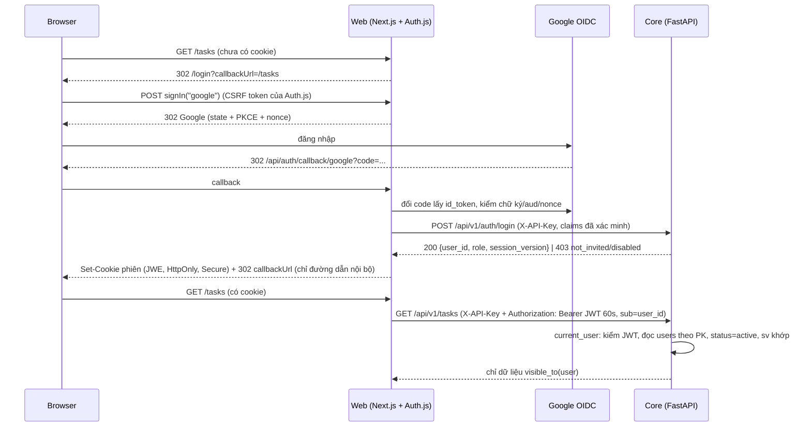

# Spec: Đăng nhập Google, quản trị user, dữ liệu task theo user đăng nhập

- Trạng thái: **CHỐT** (User duyệt 2026-10-10: Q2-Q14 theo đề xuất của architect; Q1 xem dưới)
- Quyết định Q1 (hạ tầng): giai đoạn đầu cá nhân thử MỘT MÌNH qua `localhost` + SSH tunnel (`docs/STAGING_DOMAIN_HTTPS.md`, phương án D), nên P1-P3 không bị chặn bởi domain. Prod chạy trên VM CÔNG TY với domain công ty, người dùng vào bằng mạng công ty hoặc VPN (mục 4 của tài liệu đó, `GOOGLE_ALLOWED_HD` theo domain công ty, consent screen Internal). Caddy/compose/ufw làm sau, khi có domain công ty.
- Tác giả: architect
- Ngày: 2026-10-10
- Nhánh lúc viết: `feat/auth-multiuser` (sạch, HEAD `b4587ef`)
- Alembic head lúc viết spec: `a1c9e4b7d2f8` (user_timezone_due_all_day). Migration của epic có `down_revision = "a1c9e4b7d2f8"`.
- User đã chốt trước khi viết: (C1) invite-only theo email; (C2) task `work` dùng chung cả team, task `personal` chỉ owner thấy, server tự suy "của tôi", bỏ tham số `owner`; (C3) ba role `admin`/`lead`/`member`; (C4) chế độ local (`DATA_SOURCE=file|memory`) không có auth, đa người dùng chỉ ở `DATA_SOURCE=api`; (C5) orchestrator viết `docs/GOOGLE_OAUTH_SETUP.md`, spec chỉ chốt tên biến env.
- Đã đối chiếu với code thật. Điểm lệch giữa đề bài và code ở **Phụ lục A**.

## 1. Bối cảnh & phạm vi

### 1.1. Vấn đề

Hệ thống hiện chỉ có một người dùng. Lớp xác thực duy nhất là `X-API-Key` tĩnh giữa web và core (`core/security.py`). Web không có đăng nhập: ai mở được URL (LAN, `make lan-up`, VM staging `192.168.100.202:3000`) đều đọc, ghi được mọi thứ. Thao tác hàng loạt chỉ được chặn bằng mật khẩu `X-Import-Secret` (`api/deps.py::guard_import_secret`). "Việc của tôi" do web tự gửi `owner=<tên>` lấy từ `app_settings.current_users`, một cài đặt toàn cục.

Muốn mở cho team dùng chung staging/prod thì cần: biết ai đang gọi, cô lập task cá nhân, chia quyền xem Team và quản trị.

### 1.2. Mô hình sau epic



- **Web xác thực người dùng** (Auth.js v5, Google OIDC). **Core quyết định quyền** (bảng `users`, role, status). Web không bao giờ là nơi duy nhất chặn quyền.
- Core vẫn đòi `X-API-Key` cho mọi `/api/v1/*` (chứng minh request đến từ web), cộng JWT người dùng cho mọi route trừ `/auth/login`.
- Một hàm duy nhất `visible_to(user)` quyết định task nào tồn tại với user. Task ngoài phạm vi trả **404**, không phải 403, để không lộ sự tồn tại.

### 1.3. In-scope

- **Backend:** bảng `users`, `user_aliases`, `audit_log`; cột `owner_id` ở `tasks`/`notes`/`projects`, `actor_user_id` ở `task_events`; dependency `current_user` + `require_permission`; `POST /auth/login`; `/me`; quy tắc hiển thị và quyền ghi cho task/note/project; timezone và alias theo user thay cho `app_settings` toàn cục; bỏ `X-Import-Secret`, thay bằng quyền; rate limit theo user; lệnh CLI bootstrap/backfill/invite/mint token; API quản trị user (P3); pytest cô lập A/B; cập nhật `scripts/smoke-test.sh`.
- **Web (chỉ chế độ api):** Auth.js, `middleware.ts`, trang `/login`, `lib/api.ts` gắn JWT một chỗ, `getMe()` một chỗ, `/me`, `/admin/users` (P3), ẩn nav theo quyền, bảo vệ route handler `app/api/*`, két (Vault) tách file theo user, gỡ ô nhập mật khẩu nhập dữ liệu.
- **Vận hành (orchestrator):** HTTPS + tên miền cho staging, biến env, firewall, quy trình bootstrap admin và backfill (mục 7).

### 1.4. Out-of-scope

- Postgres RLS và token Jira theo từng user (P4, mục 8).
- Chia sẻ note/task cá nhân giữa người dùng; ACL theo project.
- IdP khác Google, mật khẩu, 2FA riêng, SCIM, gửi email mời (admin tự báo cho người được mời).
- Thay đổi chế độ local: `DATA_SOURCE=file|memory` giữ nguyên hành vi một người dùng, không auth (C4). `lib/task-scope.ts::matchesView` và `current_users` của file JSON không đổi.
- Xoá cứng user có dữ liệu.
- Step-up auth (đăng nhập lại trước thao tác phá huỷ). Đề xuất ở Q11.

## 2. Thay đổi dữ liệu

### 2.1. Bảng

| Bảng | Thay đổi | Index/Constraint | Ghi chú migration (downgrade?) |
|---|---|---|---|
| `users` (mới) | `id uuid PK`, `email varchar(320) NOT NULL`, `google_sub varchar(255) NULL`, `name varchar(200) NULL`, `role varchar(16) NOT NULL DEFAULT 'member'`, `status varchar(16) NOT NULL DEFAULT 'invited'`, `timezone varchar(64) NULL`, `session_version int NOT NULL DEFAULT 0`, `invited_by uuid NULL FK users(id) ON DELETE SET NULL`, `last_login_at timestamptz NULL`, `created_at`, `updated_at` (TimestampMixin) | `uq_users_email` UNIQUE(email); `uq_users_google_sub` UNIQUE(google_sub) (NULL được lặp); `ck_users_email_normalized`: `email = lower(btrim(email)) AND position('@' in email) > 1`; `ck_users_role_valid`: `role IN ('admin','lead','member')`; `ck_users_status_valid`: `status IN ('invited','active','disabled')`; `ck_users_active_has_sub`: `status <> 'active' OR google_sub IS NOT NULL`; `ck_users_session_version_non_negative` | Tạo bảng. Downgrade: drop (sau khi drop FK ở các bảng khác). |
| `user_aliases` (mới) | `id uuid PK`, `user_id uuid NOT NULL FK users ON DELETE CASCADE`, `source varchar(32) NOT NULL`, `alias varchar(200) NOT NULL`, `created_at` | `uq_user_aliases_source_alias` UNIQUE(source, alias): một tên Jira thuộc đúng một user; `ix_user_aliases_user_id`; `ck_user_aliases_source_valid`: `source IN ('jira')`; `ck_user_aliases_alias_trimmed`: `alias = btrim(alias) AND length(alias) > 0` | Tạo bảng. Downgrade: drop. So khớp alias **chính xác, phân biệt hoa thường**, giống quy tắc `owner` hiện tại. |
| `audit_log` (mới) | `id uuid PK`, `created_at timestamptz NOT NULL DEFAULT now()`, `actor_user_id uuid NULL FK users ON DELETE SET NULL`, `action varchar(64) NOT NULL`, `target_type varchar(32) NULL`, `target_id uuid NULL`, `client_ip inet NULL`, `details jsonb NULL` | `ix_audit_log_created_at`; `ix_audit_log_actor_created` (actor_user_id, created_at). **Không** CHECK cho `action` (2.4) | Tạo bảng. Downgrade: drop, mất nhật ký. Chỉ INSERT, service không có hàm sửa/xoá. |
| `tasks` | `owner_id uuid NULL FK users ON DELETE RESTRICT` | `ix_tasks_owner_scope` (owner_id, scope) `WHERE deleted_at IS NULL`; `ck_tasks_personal_has_owner`: `scope <> 'personal' OR owner_id IS NOT NULL` tạo **NOT VALID** | Add column (metadata), tạo index, tạo CHECK NOT VALID (chỉ kiểm dòng mới/sửa). Backfill bằng CLI (mục 7.3), CLI chạy `VALIDATE CONSTRAINT` ở cuối. Downgrade: drop CHECK, index, column. |
| `notes` | `owner_id uuid NULL FK users ON DELETE RESTRICT` | `ix_notes_owner_id` `WHERE deleted_at IS NULL`; `ck_notes_owner_required`: `owner_id IS NOT NULL` NOT VALID | Như `tasks`. |
| `projects` | `owner_id uuid NULL FK users ON DELETE SET NULL` | `ix_projects_owner_id` | Add column. Không CHECK: `NULL` = project dùng chung (tạo từ Jira/nhập). Downgrade: drop. `uq` hiện tại trên `key` giữ nguyên (Q4). |
| `task_events` | `actor_user_id uuid NULL FK users ON DELETE SET NULL` | `ix_task_events_actor_created` (actor_user_id, created_at) `WHERE event_type = 'time_logged'` | Add column. Event cũ để NULL (không đoán người làm). `actor` (chuỗi) giữ nguyên, ghi thêm `user:<uuid>`. Downgrade: drop. |
| `app_settings` | **Không đổi schema.** `current_users` và `display_timezone` không còn được đọc ở chế độ api sau khi backfill. | | Backfill **sao chép**, không xoá, nên downgrade code cũ vẫn chạy. Dọn dòng thừa ở epic sau. |

### 2.2. Enum và model (backend-dev)

```python
class UserRole(StrEnum):      # CHECK ck_users_role_valid
    ADMIN = "admin"; LEAD = "lead"; MEMBER = "member"

class UserStatus(StrEnum):    # CHECK ck_users_status_valid
    INVITED = "invited"; ACTIVE = "active"; DISABLED = "disabled"

class AliasSource(StrEnum):   # CHECK ck_user_aliases_source_valid
    JIRA = "jira"
```

- Cột enum khai qua `enum_column()`, CHECK tường minh như `integration.py` (cạm bẫy `alembic check` không so CHECK).
- `User.__repr__` không in email.
- Migration viết tay: `apps/core/migrations/versions/<rev>_add_users_and_ownership.py`. Hai CHECK NOT VALID dùng `op.execute("ALTER TABLE ... ADD CONSTRAINT ... CHECK (...) NOT VALID")` và khai cùng tên trong model (`CheckConstraint(..., name=...)`) để model và DB khớp.
- Thứ tự downgrade: drop CHECK/index/FK/column ở `task_events`, `projects`, `notes`, `tasks`, rồi drop `audit_log`, `user_aliases`, `users`. Trước khi downgrade dữ liệu thật: `pg_dump -t users -t user_aliases -t audit_log` và `COPY (SELECT id, owner_id FROM tasks WHERE owner_id IS NOT NULL) TO STDOUT` (orchestrator ghi vào docs).

### 2.3. Không lưu gì của Google ngoài `sub`, email, tên

Không lưu `access_token`, `refresh_token`, `id_token`, ảnh đại diện. Web không cần gọi Google API sau khi đăng nhập. UI hiện chữ cái đầu thay cho avatar (không tải ảnh ngoài, không cần nới CSP).

### 2.4. Vì sao `audit_log.action` không có CHECK

Danh sách hành động sẽ tăng theo từng tính năng. Mỗi lần thêm mà phải viết migration DROP/ADD CHECK (và `alembic check` không bắt được nếu quên) thì rủi ro làm hỏng ghi nhật ký cao hơn lợi ích. Giá trị hợp lệ khai ở `AuditAction(StrEnum)`, service chỉ nhận enum này.

`AuditAction` ban đầu: `login_success`, `login_denied`, `user_invited`, `user_updated`, `user_role_changed`, `user_status_changed`, `user_aliases_changed`, `sessions_revoked`, `import_committed`, `integration_created`, `integration_updated`, `integration_deleted`, `integration_synced`, `bootstrap_backfill`.

`details` **không bao giờ** chứa token, cookie, JWT, mã OAuth, mật khẩu. `login_denied` ghi `reason` và email đã chuẩn hoá (để admin thấy ai bị từ chối), không ghi claim thô.

## 3. Quyền

### 3.1. Định nghĩa hiển thị (một nguồn duy nhất)

`app/services/access.py` (mới) là nơi **duy nhất** định nghĩa các điều kiện sau. `task_service`, `note_service`, `project_service` chỉ gọi hàm ở đây, không tự viết điều kiện.

```python
def task_visible_clause(user: CurrentUser) -> ColumnElement[bool]:
    # Dùng cho list, agenda, stats, trash, get, update, delete, restore, complete, time.
    return or_(Task.scope == TaskScope.WORK,
               and_(Task.scope == TaskScope.PERSONAL, Task.owner_id == user.id))

def task_view_clause(view: TaskView, user: CurrentUser) -> ColumnElement[bool] | None:
    # Thay _view_clause(view, owners). Luôn AND với task_visible_clause.
    # all      -> None (chỉ còn visible)
    # personal -> scope='personal' (visible đã ép owner_id = me)
    # work     -> scope='work'
    # mine     -> (scope='personal' AND owner_id=me)
    #             OR (scope='work' AND (assignee IN aliases(me)
    #                                   OR (assignee IS NULL AND external_id IS NULL AND owner_id=me)))

def task_permissions(user: CurrentUser, task: Task) -> TaskPerms:  # can_edit, can_delete
def note_visible_clause(user) -> ...:   # Note.owner_id == user.id (mọi role, kể cả admin)
def project_can_modify(user, project) -> bool
def has_permission(user, perm: Permission) -> bool
```

- `aliases(me)` lấy từ `user_aliases` (source `jira`), nạp cùng `current_user` một lần mỗi request.
- Nhánh "work không assignee không external_id" của quy tắc cũ thêm điều kiện `owner_id = me`: task công việc tự tạo không giao ai chỉ là "của tôi" với người tạo, không phải của cả team.
- Get/update/delete trên task không thoả `task_visible_clause` → `NotFoundError` (404). Thoả nhưng không có quyền ghi → `ForbiddenError` (403, lỗi miền mới trong `services/errors.py`).

### 3.2. Quyền (permission) theo role

Web và core kiểm theo **permission**, không so chuỗi role (skill `rbac-implementation`). Bảng role → permission khai cứng trong `app/core/permissions.py`; `/me` trả danh sách permission để web ẩn/hiện. Không có bảng `roles`/`permissions` trong DB: ba role cố định, thêm bảng chỉ làm tăng bề mặt sai cấu hình.

| Permission | member | lead | admin |
|---|:-:|:-:|:-:|
| `task:read_work` (đọc mọi task `work`) | x | x | x |
| `task:write_any_work` (sửa/xoá mọi task `work`) | | x | x |
| `team:read` (`/team`, participation, assignees) | | x | x |
| `integration:sync` (chạy sync, upsert-batch, nhập Excel/URL) | | x | x |
| `integration:manage` (tạo/sửa/xoá kết nối, sync_urls) | | | x |
| `project:write_any` | | x | x |
| `data:import` (nhập JSON vào Postgres) | | | x |
| `user:manage` (mời, đổi role/status, alias, thu hồi phiên, audit) | | | x |
| `system:read` (`/system/info`) | | | x |

**Không ai** (kể cả admin) đọc được task `personal` hay note của người khác qua API (Q2).

### 3.3. Quyền ghi trên task

| Thao tác | `personal` | `work` |
|---|---|---|
| Đọc | chỉ owner | mọi user |
| Sửa (PATCH, status, lịch, ghi giờ, complete) | chỉ owner | `task:write_any_work`, hoặc `assignee ∈ aliases(me)`, hoặc (`owner_id = me` và `external_id IS NULL`) |
| Xoá mềm, phục hồi, xoá vĩnh viễn | chỉ owner | `task:write_any_work`, hoặc (`owner_id = me` và `external_id IS NULL`) |
| Đổi `personal → work` | owner (task thành dùng chung, `owner_id` giữ nguyên) | |
| Đổi `work → personal` | | chỉ khi `external_id IS NULL` và người gọi sửa được task; `owner_id` đặt thành người gọi. Task có `external_id` (Jira) → 409 `shared_task_cannot_be_personal` (Q6) |
| Tạo (POST) | `owner_id = me`, client không gửi được `owner_id` | như trái |

Task do sync/upsert/nhập tạo với `scope=work` có `owner_id = NULL` (thuộc team). Ghi `actor_user_id` của người kích hoạt vào `task_events`.

### 3.4. Ma trận endpoint (core, prefix `/api/v1`)

Mọi dòng dưới đây cần `X-API-Key`. "JWT" = cần `Authorization: Bearer` hợp lệ, user `active`.

| Endpoint | Xác thực | member | lead | admin | Ghi chú |
|---|---|:-:|:-:|:-:|---|
| `POST /auth/login` | chỉ API key | - | - | - | Web gọi lúc callback |
| `GET /me`, `PUT /me/timezone` | JWT | x | x | x | |
| `GET /settings/timezones` | JWT | x | x | x | |
| `GET/PUT /settings/current-users` | | | | | **Gỡ** (thay bằng alias) |
| `GET/PUT /settings/display-timezone` | | | | | **Gỡ** (thay bằng `/me/timezone`) |
| `GET/PUT /settings/sync-urls` | JWT | | | x | Cài đặt toàn cục (Q13) |
| `GET /tasks`, `/tasks/agenda`, `/tasks/stats` | JWT | x | x | x | Lọc `visible_to`; bỏ `owner` |
| `GET /tasks/{id}`, `POST /tasks`, `PATCH`, `DELETE`, `/restore`, `/complete`, `/time` | JWT | x | x | x | 404/403 theo 3.1, 3.3 |
| `GET /tasks/trash`, `POST /tasks/trash/empty` | JWT | x | x | x | Chỉ task visible; `empty` chỉ xoá task người gọi được xoá |
| `POST /tasks/trash/purge` | JWT | x | x | x | Dọn quá hạn toàn hệ thống (chính sách lưu giữ, không phải quyền) |
| `GET /tasks/participation`, `GET /tasks/assignees` | JWT | | x | x | `team:read` |
| `POST /tasks/upsert-batch` | JWT | | x | x | `integration:sync`; **bỏ** `X-Import-Secret` |
| `/notes/**` | JWT | x | x | x | Chỉ note của mình; stats/trash theo mình |
| `GET /projects`, `GET /projects/{id}` | JWT | x | x | x | Mọi project (Q4) |
| `POST /projects` | JWT | x | x | x | `owner_id = me` |
| `PATCH/DELETE /projects/{id}` | JWT | owner | x | x | `project:write_any` hoặc `owner_id = me` |
| `GET /integrations` | JWT | | x | x | |
| `POST/PATCH/DELETE /integrations[/{id}]` | JWT | | | x | |
| `POST /integrations/{id}/sync` | JWT | | x | x | **bỏ** `X-Import-Secret`; JQL dự phòng dùng alias của người gọi |
| `POST /import/datafile` | JWT | | | x | **bỏ** `X-Import-Secret`; vẫn giữ `expect_replaced` + `expect_sha256` |
| `POST /import/verify-secret` | | | | | **Gỡ** |
| `GET /system/info` | JWT | | | x | |
| `/admin/users/**`, `/admin/audit-log` (P3) | JWT | | | x | `user:manage` |
| `/health/*` | không | | | | Không đổi |

### 3.5. Ma trận trang (web, chế độ api)

| Trang | member | lead | admin | Không đủ quyền |
|---|:-:|:-:|:-:|---|
| `/login` | công khai | | | Có phiên thì chuyển `/` |
| `/`, `/tasks`, `/projects`, `/notes`, `/tags`, `/trash`, `/vault`, `/me` | x | x | x | |
| `/team`, `/team/participation` | | x | x | Panel "Không đủ quyền" (không 404, vì menu đã ẩn) |
| `/data` | x (chỉ phần xuất của mình) | x (+ nhập Excel/URL, sync Jira) | x (+ nhập JSON, kết nối, sync_urls) | Ẩn tab |
| `/system` | | | x | Panel "Không đủ quyền" |
| `/admin/users` (P3) | | | x | Panel "Không đủ quyền" |
| `/docs`, `/architecture`, `/roadmap`, `/api-docs`, `/ai/*` | x | x | x | Cần đăng nhập, không cần quyền riêng |

## 4. API contract

### 4.1. Xác thực core

`app/core/auth.py` (mới):

- JWT **HS256**, bí mật `CORE_JWT_SECRET` (≥ 32 byte, khác `API_KEY` và `AUTH_SECRET`). Claim bắt buộc: `iss="builder-web"`, `aud="builder-core"`, `sub=<user uuid>`, `sv=<session_version>`, `iat`, `exp` (≤ 60 giây sau `iat`), `jti`. Khi verify: ghim `algorithms=["HS256"]`, leeway 10 giây, từ chối `exp - iat > 120`. Thư viện `PyJWT` (thêm vào `pyproject.toml`, `make lock`).
- `current_user` dependency: verify JWT → `SELECT users + aliases WHERE id = sub` **mỗi request, không cache** (một truy vấn theo PK; đổi lại disable/thu hồi phiên có hiệu lực ngay, không phải lo vô hiệu cache giữa nhiều worker). Lỗi:
  - thiếu/sai chữ ký/hết hạn/sai `aud` → 401 `{"detail": "...", "code": "token_invalid"}`
  - user không tồn tại, `status != active`, hoặc `sv` lệch → 401 `code: "user_inactive"`
- `require_permission(perm)` → 403 `code: "forbidden"`.
- `bind_display_tz` đổi thành: `clock.set_request_tz(user.timezone or settings.display_timezone)`. Bỏ cache tiến trình theo `app_settings` ở chế độ này (múi giờ đi theo user).
- Router: `api_router` (API key) chứa `auth_router` (không JWT) và `user_router` (`dependencies=[Depends(current_user), Depends(bind_display_tz)]`) chứa mọi router hiện có.
- `core/rate_limit.py::_identity`: nếu có `Authorization` hợp lệ (verify chữ ký, không chạm DB) thì `user:<sub>`, ngược lại như cũ. Nếu không đổi, mọi user chung một bucket 120/phút của API key web. Thêm bucket riêng cho `/api/v1/auth/login`: 20/phút theo `client_ip` do web chuyển (4.2) và 60/phút toàn cục.

### 4.2. Endpoint mới

| Method | Path | Request | Response | Lỗi |
|---|---|---|---|---|
| POST | `/auth/login` | `LoginRequest { google_sub: str(1..255), email: str(3..320), email_verified: bool, name: str(..200) \| None, hd: str(..255) \| None, client_ip: str(..45) \| None }` | 200 `LoginResult { user_id: UUID, role: UserRole, session_version: int }` | 403 `code ∈ {not_invited, disabled, email_unverified, hd_not_allowed, account_mismatch}` (detail chung chung, xem 6), 422, 429 |
| GET | `/me` | | `MeRead { id, email, name, role, status, timezone: str \| None, effective_timezone: str, aliases: list[AliasRead], permissions: list[Permission] }` | 401 |
| PUT | `/me/timezone` | `{ timezone: str \| None }` (None = về mặc định env) | `MeRead` | 422 tên IANA sai |
| GET | `/admin/users` (P3) | `q` (email/tên, ≤ 200), `role`, `status`, `limit` (1..200, mặc định 50), `offset` | `Page[UserRead]` (sắp `created_at desc, id desc`) | 403 |
| POST | `/admin/users` (P3) | `UserInvite { email, role = member, name? }` | 201 `UserRead` (status `invited`) | 409 `email_exists`, 422 |
| GET | `/admin/users/{id}` (P3) | | `UserRead` (kèm `aliases`) | 404 |
| PATCH | `/admin/users/{id}` (P3) | `UserUpdate { role?, status?: active \| disabled, name? }` | `UserRead` | 409 `last_admin` (hạ quyền/khoá admin active cuối cùng), 409 `self_lockout` (tự hạ quyền/khoá mình), 409 `env_admin` (email trong `ADMIN_EMAILS` không hạ/khoá qua UI), 422 `status=active` khi chưa có `google_sub` |
| POST | `/admin/users/{id}/revoke-sessions` (P3) | | 204 (`session_version += 1`) | 404 |
| PUT | `/admin/users/{id}/aliases` (P3) | `{ aliases: list[{source: "jira", alias: str(1..200)}] }` (≤ 20, thay toàn bộ) | `UserRead` | 409 `alias_taken` (kèm email người đang giữ), 422 |
| DELETE | `/admin/users/{id}` (P3) | | 204 | 409 `has_data` (chỉ xoá được user `invited` chưa sở hữu dữ liệu nào) |
| GET | `/admin/audit-log` (P3) | `actor_user_id?`, `action?`, `limit` (mặc định 50), `offset` | `Page[AuditRead]` | 403 |

Logic `/auth/login` (service `auth_service.login`, một transaction, `SELECT ... FOR UPDATE` theo email):
1. `email_verified` phải true → không thì `email_unverified`.
2. Nếu `GOOGLE_ALLOWED_HD` (core đọc cùng biến) có giá trị: `hd` phải nằm trong danh sách → không thì `hd_not_allowed`. Web cũng kiểm, core kiểm lại.
3. Tìm theo `google_sub`. Có: kiểm status (`disabled` → từ chối), cập nhật email nếu Google đổi (nếu email mới trùng user khác → `account_mismatch`).
4. Không có: tìm theo `email` (đã `lower(strip)`). Không thấy → `not_invited`. Thấy mà `google_sub` đã gắn sub khác → `account_mismatch`. Thấy, `status = invited` → gắn `google_sub`, `status = active`. `disabled` → `disabled`.
5. Cập nhật `last_login_at`, `name`. Ghi `audit_log` (`login_success` / `login_denied` kèm `reason`).

Email chỉ chuẩn hoá `lower(strip)`, **không** bỏ dấu chấm hay `+tag` của Gmail: admin mời đúng địa chỉ người dùng đăng nhập.

### 4.3. Thay đổi endpoint hiện có

- `GET /tasks`, `/tasks/agenda`, `/tasks/stats`: **bỏ** tham số `owner`. `view` giữ 4 giá trị, ngữ nghĩa theo 3.1. Mặc định của `view` vẫn là `all` (nay là "mọi thứ tôi thấy được"). `validate_view_params` và `MAX_OWNERS` bị gỡ.
- `get_stats`: `trash_total` đếm task đã xoá **và** visible; `minutes_logged_today` cộng event `time_logged` có `actor_user_id = me`. Hai số này vẫn không lọc theo `view` (S15 của task-scope).
- `get_participation`, `list_assignees`: chỉ `scope=work` (đã vậy), chỉ thêm kiểm quyền.
- `TaskRead` thêm `owner_id: UUID | None`, `can_edit: bool`, `can_delete: bool` (tính ở tầng API bằng `access.task_permissions`, để web ẩn nút mà không chép lại quy tắc). `NoteRead`, `ProjectRead` thêm `owner_id`; `ProjectRead` thêm `can_edit`.
- `TaskCreate`, `NoteCreate`, `ProjectCreate`: **không** nhận `owner_id`. Gửi lên bị bỏ qua (Pydantic `extra="ignore"` như hiện tại) và có test chứng minh không đổi được chủ.
- `POST /import/datafile`: task `personal` và note **tạo mới** nhận `owner_id = admin đang nhập`; bản ghi bị **ghi đè** giữ `owner_id` đang có trong DB. `meta.current_users` của file → thêm vào alias của người nhập (bỏ qua tên đã thuộc user khác, cảnh báo `alias_taken`). `meta.display_timezone` → `users.timezone` của người nhập nếu đang `NULL`. Ghi `audit_log` `import_committed`.
- `POST /integrations/{id}/sync`: khi kết nối không có JQL, dùng alias `jira` của người gọi (thay cho `app_settings.current_users`). Không có alias → 422 như hôm nay.
- `api/deps.py::guard_import_secret`, `ImportSecretHeader`, `settings.import_commit_secret`: gỡ. Core khởi động mà còn biến `IMPORT_COMMIT_SECRET` thì log WARNING "biến đã bỏ, không còn tác dụng", không lỗi.

### 4.4. Cấu hình core mới (`core/config.py`)

| Biến | Bắt buộc | Ý nghĩa |
|---|---|---|
| `CORE_JWT_SECRET` | có (SecretStr, ≥ 32 ký tự) | Kiểm JWT người dùng do web ký. Thiếu thì core **không khởi động** (fail closed) |
| `ADMIN_EMAILS` | không (NoDecode, phân cách dấu phẩy) | Email luôn là admin. Lúc khởi động core upsert: chưa có thì tạo `invited` role `admin`; có rồi thì ép `role=admin` (không đổi status). Không hạ/khoá được qua UI (`env_admin`). Là đường "phá kính" khi lỡ khoá hết admin |
| `GOOGLE_ALLOWED_HD` | không | Danh sách Google Workspace domain được phép; rỗng = mọi tài khoản đã được mời |

## 5. Thay đổi Web

Toàn bộ mục này **chỉ áp khi `DATA_SOURCE=api`**. Ở `file|memory`: middleware cho qua, `/login` chuyển về `/`, `/me` và `/admin/users` hiện `LocalOnlyNotice`, `lib/api.ts` không gắn JWT. Ở `api` mà thiếu biến auth (5.6) thì web trả trang lỗi cấu hình, **không** mở cửa không đăng nhập.

### 5.1. Auth.js

- Thêm `next-auth@5` (**pin chính xác** phiên bản, không `^`) và `jose`. Nâng `next` lên bản 15.x mới nhất (tối thiểu 15.2.3, bản vá CVE-2025-29927 bypass middleware qua header `x-middleware-subrequest`).
- `auth.ts` (gốc `apps/web`): provider Google, `session.strategy = "jwt"`, **không** adapter DB (user nằm ở core). `session.maxAge` 7 ngày (Q8). Cookie mặc định của Auth.js khi chạy HTTPS: `__Secure-` prefix, `HttpOnly`, `SameSite=Lax`, `Secure`.
  - `authorization.params`: `prompt: "select_account"`; nếu có `GOOGLE_ALLOWED_HD` một giá trị thì thêm `hd` (chỉ là gợi ý UI, không phải kiểm tra bảo mật).
  - `callbacks.signIn({ profile })`: từ chối nếu `profile.email_verified !== true`, hoặc `hd` không thuộc `GOOGLE_ALLOWED_HD`; rồi gọi `coreLogin()` (`lib/api.ts`, chỉ API key). 403 từ core → trả `"/login?error=<code>"`.
  - `callbacks.jwt`: lần đăng nhập lưu `uid`, `sv`, `role` vào token phiên. **Không** lưu `access_token`/`id_token` vào token phiên.
  - `callbacks.redirect({ url, baseUrl })`: chỉ chấp nhận URL tương đối bắt đầu bằng `/` nhưng không phải `//` hoặc `/\`, hoặc URL tuyệt đối cùng origin với `baseUrl`; còn lại trả `baseUrl`.
  - `debug: false` khi `NODE_ENV=production`; `logger` tuỳ biến không in object lỗi có chứa token.
- `app/api/auth/[...nextauth]/route.ts`: export `GET`, `POST` từ `auth.ts`.

### 5.2. `middleware.ts` (mới)

- Matcher loại trừ `/_next/*`, `/favicon.ico`, file tĩnh, `/api/auth/*`.
- Không có phiên → 302 `/login?callbackUrl=<pathname+search>` (chỉ đường dẫn tương đối). Có phiên mà vào `/login` → 302 `/`. `/admin/*`, `/system`, `/team*`: chỉ kiểm phiên tồn tại; quyền kiểm ở trang và ở core.
- Middleware **không phải ranh giới bảo mật** (CVE kể trên). Ranh giới là: `lib/api.ts` không có phiên thì không gọi core; core đòi JWT.
- Cách đọc `DATA_SOURCE` trong middleware phải chạy ở runtime trong image standalone (không nhúng lúc build). frontend-dev kiểm bằng nghiệm thu 6.3.

### 5.3. `lib/api.ts`: một chỗ lấy user, một chỗ gắn JWT

- `getSessionUser()` (bọc `cache()`): `auth()` của Auth.js, trả `{ uid, sv } | null`.
- `coreFetch()`: ở chế độ api, không có phiên → `CoreApiError("Chưa đăng nhập", 401)`. Có phiên → ký JWT 60 giây bằng `jose` (`CORE_JWT_SECRET`), gửi `Authorization: Bearer` kèm `X-API-Key`. Core trả 401 `user_inactive` → `CoreApiError` có `code`.
- `coreLogin(claims, clientIp)`: chỉ dùng trong `signIn` callback, chỉ API key.
- `getMe()` (bọc `cache()`): `GET /api/v1/me`. Root layout gọi `getMe()` **chỉ khi có phiên** (để `/login` không gọi core). 401 → `redirect("/auth/expired")`. `getDisplayTimezoneApi()` ở chế độ api lấy `me.effective_timezone`.
- `hasPermission(me, perm)` thuần, dùng chung trang và Server Action.
- Gỡ: `ownersFor`, `owner` trong `appendView`, `getCurrentUsersApi`/`setCurrentUsersApi` ở nhánh api (giữ nhánh local), `verifyImportSecret`, tham số `secret` của `postImport`/`syncIntegration`/`upsertTasksBatch`.
- Mới: `setMyTimezoneApi`, (P3) `listUsers`, `inviteUser`, `updateUser`, `revokeUserSessions`, `setUserAliases`, `deleteUser`, `listAuditLog`.
- `client_ip` cho `/auth/login` lấy từ `X-Forwarded-For` **hop đầu do Caddy đặt** (Caddy ghi đè header, không nối chuỗi client gửi).

### 5.4. Route / trang

| Route | Thay đổi |
|---|---|
| `app/login/page.tsx` (mới) | Nút "Đăng nhập với Google" (form Server Action gọi `signIn("google", { redirectTo })`, `redirectTo` đã lọc như 5.1). Map `error` → thông báo chung: `not_invited`/`disabled`/`account_mismatch` đều hiện "Tài khoản này chưa được cấp quyền truy cập. Liên hệ quản trị viên." (không cho biết email có trong hệ thống hay không); `email_unverified`, `hd_not_allowed` có thông báo riêng (không lộ gì). |
| `app/auth/expired/route.ts` (mới) | GET: xoá cookie phiên (`signOut({ redirect: false })`), 302 `/login?error=session`. Không vòng lặp vì `/login` không gọi `getMe()` khi không có phiên. |
| `app/me/page.tsx` (mới) | Hồ sơ: email, tên, role, alias Jira (**chỉ đọc**, Q5), chọn múi giờ (chuyển `TimezoneSelector` từ `/data` sang đây ở chế độ api). |
| `app/admin/users/page.tsx` (P3, mới) | Bảng user, phân trang server-side `?page=` 50/trang, lọc `q`/`role`/`status` giữ trong URL, thanh "Trang x / y", "Tổng: n". Form mời. Mỗi dòng: đổi role, khoá/mở, thu hồi phiên, sửa alias (gợi ý từ `/tasks/assignees`), xoá (chỉ `invited` chưa có dữ liệu). |
| `app/admin/audit/page.tsx` (P3, mới) | Nhật ký, phân trang 50/trang. |
| `app/team/**`, `app/system/page.tsx` | Kiểm `hasPermission`; thiếu thì panel "Không đủ quyền". |
| `app/data/page.tsx` | Chế độ api: bỏ khối "Tên của tôi" (thay bằng link `/me`); tab nhập JSON chỉ `data:import`; sync Jira/Excel/URL chỉ `integration:sync`; quản lý kết nối và `sync_urls` chỉ `integration:manage`. Gỡ mọi ô mật khẩu nhập. |
| `app/layout.tsx` + sidebar | Lấy `me` (khi có phiên); truyền cho sidebar lọc nav; menu user (tên, role, "Hồ sơ", "Đăng xuất" là form POST `signOut`). |
| `lib/nav.ts` | `NavItem.permission?: Permission`; thêm `/admin/users` (`user:manage`), `/me` vào menu user. `/team` gắn `team:read`, `/system` gắn `system:read`. |
| `app/api/export/route.ts` | Chế độ api: không có phiên → 401. `entity=vault` → file két **của user hiện tại**. Các entity khác đọc store cục bộ, ở chế độ api trả 501 (hôm nay đã không có dữ liệu thật ở chế độ này, Phụ lục A mục 6). |

### 5.5. Server Action

- Mọi action ghi dữ liệu đi qua `lib/api.ts` nên tự có xác thực (không phiên → 401). Thêm `requirePermission(perm)` (`lib/auth-guard.ts`, `"server-only"`) ở đầu các action cần quyền, để trả lỗi sớm và rõ; core vẫn là bên quyết định.
- `actions.ts::importToCoreAction`, `syncFromUrlAction`: gỡ `secret`/`verifyImportSecret`; kiểm `data:import` / `integration:sync`.
- `jira-actions.ts::syncIntegrationAction`, `saveIntegrationAction`, `clearIntegrationTokenAction`, `deleteIntegrationAction`, `migrateLocalIntegrationsAction`: gỡ `secret`; kiểm `integration:sync` / `integration:manage`.
- `actions-import.ts::importBulkTasksAction`, `importBulkFileAction`: kiểm `integration:sync` ở chế độ api.
- `actions-user.ts`: `setCurrentUserAction` chỉ còn nhánh local (api → lỗi "Alias do quản trị viên quản lý"); `setDisplayTimezoneAction` ở api gọi `setMyTimezoneApi`.
- `vault-actions.ts`: ở chế độ api, đường file két là `vault-<user_id>.json` (`user_id` đã kiểm UUID) thay vì `vault.json` chung (`lib/vault/store.ts` nhận tham số). Chế độ local giữ `vault.json`.
- `app/admin/actions.ts` (P3, mới): `inviteUserAction`, `updateUserAction`, `revokeSessionsAction`, `setAliasesAction`, `deleteUserAction`; validate input (email, role, status thuộc enum; alias ≤ 20, mỗi alias 1-200 ký tự, không ký tự điều khiển; id là UUID) trước khi gọi core.
- Server Action của Next kiểm `Origin` khớp `Host`. Sau reverse proxy phải giữ `Host` gốc (Caddy mặc định giữ) và đặt `experimental.serverActions.allowedOrigins` = host công khai trong `next.config.ts`.

### 5.6. Biến môi trường web (chốt tên)

| Biến | Bắt buộc ở api | Ghi chú |
|---|---|---|
| `AUTH_SECRET` | có | Khoá mã hoá cookie phiên của Auth.js, `openssl rand -base64 32` |
| `AUTH_URL` | có | URL công khai, ví dụ `https://ai-stg.<domain>` |
| `AUTH_TRUST_HOST` | có (`true`) | Chạy sau Caddy |
| `AUTH_GOOGLE_ID`, `AUTH_GOOGLE_SECRET` | có | OAuth client (Auth.js v5 tự nhận tên này) |
| `GOOGLE_ALLOWED_HD` | không | Như core, phải cùng giá trị |
| `CORE_JWT_SECRET` | có | Cùng giá trị với core |
| `CORE_API_KEY`, `CORE_API_URL` | có | Không đổi |

Không biến nào là `NEXT_PUBLIC_*`. Redirect URI đăng ký ở Google: `${AUTH_URL}/api/auth/callback/google`; dev: `http://localhost:3000/api/auth/callback/google`.

## 6. Threat model ngắn

| Mối đe doạ | Biện pháp |
|---|---|
| CSRF đăng nhập/đăng xuất | `signIn`/`signOut` là POST kèm CSRF token double-submit của Auth.js; OAuth có `state` + PKCE + `nonce`. Server Action có kiểm `Origin`. Cookie `SameSite=Lax`. |
| Session fixation | Không có phiên trước đăng nhập; Auth.js phát cookie JWE mới sau callback. Đăng xuất xoá cookie. Thu hồi bằng `session_version`. |
| Open redirect qua `callbackUrl` | `callbacks.redirect` (5.1) và trang `/login` cùng lọc: chỉ đường dẫn nội bộ, chặn `//`, `/\`, scheme lạ. |
| User bị khoá vẫn dùng được | Core đọc `status`, `session_version` mỗi request, không cache. Layout gọi `/me` mỗi lần render nên cả trang không gọi dữ liệu cũng bị đẩy ra. Thời gian trễ tối đa = một request. |
| Tài khoản Google chưa xác minh email / sai domain | Kiểm `email_verified` và `hd` ở cả web lẫn core. |
| Chiếm tài khoản qua đổi email Google | Khoá chính là `google_sub`, không phải email. Email chỉ dùng một lần để khớp lời mời. |
| Dò email đã được mời | Thông báo lỗi giống nhau cho `not_invited`/`disabled`/`account_mismatch`; rate limit `/auth/login`. |
| Leo quyền qua alias | Alias quyết định quyền ghi task `work` nên chỉ admin sửa (Q5); unique `(source, alias)` để một tên Jira không thuộc hai người. |
| IDOR task/note | Mọi truy vấn qua `access.*_visible_clause`; ngoài phạm vi trả 404. Test A/B (7.1). |
| Bypass middleware | Middleware chỉ là UX; `lib/api.ts` và core tự xác thực. Nâng Next ≥ 15.2.3. |
| Lộ secret qua log | Không log `id_token`, `access_token`, cookie, JWT, header `Authorization`; core log `user_id` thay cho email; `audit_log.details` không chứa claim thô; Auth.js `debug` tắt ở production. |
| Web bị chiếm | Kẻ tấn công ký được JWT cho mọi user (giống hôm nay có `API_KEY`). Chấp nhận ở P1-P3; P4 thêm RLS để giới hạn thiệt hại khi core có lỗi truy vấn. |
| Khoá hết admin | `last_admin`, `self_lockout`, và `ADMIN_EMAILS` là đường phá kính. |
| HTTP trên LAN | Bắt buộc HTTPS (cookie `Secure`, Google không nhận redirect URI là IP). Web chỉ bind `127.0.0.1`, Caddy là cửa duy nhất. |

## 7. Vận hành: dev, staging (Proxmox)

### 7.1. Dev trên máy

- Chế độ local (`make use-local`): như cũ, không auth.
- Chế độ api (`make use-db`): cần OAuth client **dev** riêng với redirect `http://localhost:3000/api/auth/callback/google`. Không có cờ tắt auth. `ADMIN_EMAILS=<email của User>`. Gọi API bằng tay: `make auth-token EMAIL=<email>` in JWT 60 giây (CLI chạy trong container `api`, ai vào được container thì vốn đã có toàn quyền).

### 7.2. Staging `ai-stg-01` (192.168.100.202)

1. **Tên miền + HTTPS.** Google không nhận redirect URI là IP hay đuôi không phải tên miền công khai (`.lan`, `.local`). Cần tên như `ai-stg.<domain-của-User>` trỏ về `192.168.100.202` (DNS nội bộ hoặc bản ghi A công khai trỏ IP riêng). Chứng chỉ: Caddy + Let's Encrypt qua **DNS-01** (VM không cần mở ra internet). Phương án thay thế ở Q1.
2. **Caddy** (service mới trong `docker-compose.prod.yml`, profile `edge`): nghe 443, `reverse_proxy web:3000`, ghi đè `X-Forwarded-For`/`X-Forwarded-Proto`, HSTS. Web vẫn bind `127.0.0.1:3000`. `ufw`: mở 443 (và 80 nếu dùng HTTP-01) từ `192.168.100.0/24`, đóng 3000.
3. **`.env`** trên VM (thêm vào bảng mục 6 của `PROXMOX_DEPLOY.md`): `AUTH_SECRET`, `AUTH_URL=https://ai-stg.<domain>`, `AUTH_TRUST_HOST=true`, `AUTH_GOOGLE_ID`, `AUTH_GOOGLE_SECRET`, `CORE_JWT_SECRET`, `ADMIN_EMAILS`, `GOOGLE_ALLOWED_HD` (tuỳ chọn), `CORS_ORIGINS=https://ai-stg.<domain>`; gỡ `IMPORT_COMMIT_SECRET`. `make env` sinh sẵn `AUTH_SECRET`, `CORE_JWT_SECRET` ngẫu nhiên. Staging và prod: **OAuth client và secret khác nhau**.
4. **Google Console:** redirect `https://ai-stg.<domain>/api/auth/callback/google` (chi tiết ở `docs/GOOGLE_OAUTH_SETUP.md`).

### 7.3. Lần nâng cấp đầu tiên (có dữ liệu thật)

```bash
make backup                                   # pg_dump trước mọi thứ
# deploy image mới (P1 + P2 cùng lúc, mục 8)
make migrate                                  # tạo bảng, cột NULL, CHECK NOT VALID
make auth-bootstrap OWNER=<email-admin> DRY=1 # in số dòng sẽ đổi, không ghi
make auth-bootstrap OWNER=<email-admin>       # ghi thật
```

`make auth-bootstrap` gọi `python -m app.cli.auth bootstrap --owner <email>` trong container `api`. Idempotent, một transaction:
1. Upsert user từ `ADMIN_EMAILS` (như lúc khởi động). `OWNER` phải là một trong số đó.
2. `UPDATE tasks SET owner_id = :owner WHERE owner_id IS NULL AND scope = 'personal'`; `UPDATE notes SET owner_id = :owner WHERE owner_id IS NULL`. Task `work` để `NULL`. Project để `NULL` (dùng chung). **Không** đụng `updated_at` (cùng lý do như backfill `scope`: tránh báo nhầm `file_older_than_db` ở lần nhập sau).
3. Sao chép `app_settings.current_users` thành alias `jira` của `OWNER` (bỏ qua tên đã thuộc user khác, in cảnh báo); `display_timezone` thành `users.timezone` của `OWNER` nếu đang NULL. Không xoá dòng `app_settings`.
4. `ALTER TABLE tasks VALIDATE CONSTRAINT ck_tasks_personal_has_owner`; tương tự `ck_notes_owner_required`.
5. Ghi `audit_log` `bootstrap_backfill` với số dòng.

Sau đó: đổi tên file két trên volume web `vault.json` → `vault-<owner_id>.json` (lệnh in ra ở bước 5, orchestrator ghi vào runbook). Admin đăng nhập lần đầu → `active`. Mời người khác: P3 qua `/admin/users`; trước P3 bằng `make auth-invite EMAIL=<email> ROLE=member|lead|admin`.

## 8. Phân pha và Ownership

| Pha | Nội dung | Ai |
|---|---|---|
| **P1** backend | Migration, model, `access.py`, `permissions.py`, `core/auth.py`, `/auth/login`, `/me`, `/me/timezone`, phạm vi hoá task/note/project/trash/stats, quyền trên mọi route (3.4), gỡ import secret, rate limit theo user, CLI (`bootstrap`, `invite`, `token`), pytest, smoke | backend-dev |
| **P2** web | Auth.js, middleware, `/login`, `/auth/expired`, `lib/api.ts`, `getMe`, `/me`, nav theo quyền, gỡ ô mật khẩu, két theo user, export route, Server Action guard | frontend-dev |
| **P3** admin | Backend: `/admin/users/**`, `/admin/audit-log`. Web: `/admin/users`, `/admin/audit`, `app/admin/actions.ts` | backend-dev, rồi frontend-dev |
| **P4** | Postgres RLS (`SET LOCAL app.user_id` mỗi transaction, policy trên `tasks`/`notes`), token Jira theo user, step-up auth (Q11). Spec riêng | sau |
| Hạ tầng | Caddy, compose, `ufw` (ansible), `Makefile` target, `.env.example`, docs | orchestrator, sau khi User chốt Q1 |

**P1 và P2 phải lên staging cùng lúc**: P1 một mình làm web chế độ api hỏng (core đòi JWT). Merge vào `main` theo thứ tự P1 → sinh types → P2 trong cùng một đợt promote.

### 8.1. backend-dev (`apps/core/**`, `scripts/smoke-test.sh`)

- `app/models/user.py` (mới: `User`, `UserAlias`), `app/models/audit_log.py` (mới), `app/models/enums.py`, `app/models/__init__.py`, `app/models/task.py`, `app/models/note.py`, `app/models/project.py`
- `migrations/versions/<rev>_add_users_and_ownership.py` (mới)
- `app/core/config.py`, `app/core/security.py`, `app/core/auth.py` (mới), `app/core/permissions.py` (mới), `app/core/rate_limit.py`
- `app/api/deps.py`, `app/api/v1/router.py`, `app/api/v1/auth.py` (mới), `app/api/v1/me.py` (mới), `app/api/v1/admin.py` (mới, P3), `app/api/v1/tasks.py`, `notes.py`, `projects.py`, `settings.py`, `imports.py`, `integrations.py`, `system.py`
- `app/schemas/user.py` (mới), `app/schemas/auth.py` (mới), `app/schemas/task.py`, `note.py`, `project.py`, `settings.py`, `imports.py`
- `app/services/access.py` (mới), `auth_service.py` (mới), `user_service.py` (mới), `audit_service.py` (mới), `errors.py`, `task_service.py`, `note_service.py`, `project_service.py`, `settings_service.py`, `import_service.py`, `integration_service.py`, `integration_sync_service.py`, `task_sync_service.py`, `clock.py`
- `app/cli/__init__.py`, `app/cli/auth.py` (mới), `app/main.py` (lifespan upsert `ADMIN_EMAILS`)
- `pyproject.toml`, `uv.lock` (PyJWT)
- `tests/**` (thêm `tests/test_auth.py`, `tests/test_isolation.py`, `tests/test_admin_users.py`; sửa `conftest.py` để TRUNCATE bảng mới và cung cấp fixture user/token)
- `scripts/smoke-test.sh` (lấy token qua `make auth-token`)

### 8.2. frontend-dev (`apps/web/**` trừ `lib/generated/**`, `lib/docs.ts`)

- `package.json`, `package-lock.json`, `next.config.ts`
- `auth.ts` (mới), `middleware.ts` (mới), `app/api/auth/[...nextauth]/route.ts` (mới), `app/auth/expired/route.ts` (mới), `app/login/page.tsx` (mới), `app/me/page.tsx` (mới), `app/admin/users/page.tsx`, `app/admin/audit/page.tsx`, `app/admin/actions.ts` (P3, mới)
- `lib/api.ts`, `lib/types.ts`, `lib/auth-guard.ts` (mới), `lib/permissions.ts` (mới, hằng permission khớp backend), `lib/nav.ts`, `lib/vault/store.ts`
- `app/layout.tsx`, `app/actions.ts`, `app/actions-user.ts`, `app/actions-import.ts`, `app/jira-actions.ts`, `app/vault-actions.ts`, `app/actions-danger.ts`, `app/api/export/route.ts`
- `app/data/page.tsx`, `app/team/page.tsx`, `app/team/participation/page.tsx`, `app/system/page.tsx`, `app/tasks/page.tsx`, `app/page.tsx`
- `components/` liên quan: sidebar/nav, `user-menu.tsx` (mới), `core-import-panel.tsx`, `jira-sync-manager.tsx`, `jira-quick-sync.tsx`, `task-item.tsx` (ẩn nút theo `can_edit`/`can_delete`), `components/admin/*` (mới, P3)

### 8.3. orchestrator

- Sinh lại `apps/web/lib/generated/openapi.d.ts` sau P1 và sau P3 backend.
- `docs/GOOGLE_OAUTH_SETUP.md` (mới), `docs/PROXMOX_DEPLOY.md` (mục 6, mục bootstrap), `docs/API_REFERENCE.md`, `docs/AI_HANDOFF_STATE.md`, `apps/web/lib/docs.ts` (đăng ký spec này và docs mới), `.agents/rules/backend-conventions.md` (quy tắc "mọi truy vấn qua `access.*`"), `.agents/rules/web-conventions.md` (quy tắc auth ở chế độ api).
- Hạ tầng: `docker-compose.prod.yml`, `infra/caddy/Caddyfile` (mới), `infra/ansible/**` (ufw), `Makefile` (`auth-bootstrap`, `auth-invite`, `auth-token`, `backup` nếu chưa có), `.env.example`.

**Không ai sửa:** `data/**`, `lib/store/engine.ts`, `lib/store/json-file.ts`, `lib/task-scope.ts` (chế độ local giữ nguyên).

## 9. Tiêu chí nghiệm thu (kiểm chứng được)

`TEST_DATABASE_URL` trỏ DB `_test`. Test `db` bị skip thì **không tính là pass**.

### 9.1. Backend (P1, P3)

- [ ] `uv run ruff check app migrations tests` và `uv run ruff format --check app migrations tests` → exit 0.
- [ ] `uv run alembic heads` → một head, `down_revision = "a1c9e4b7d2f8"`.
- [ ] `alembic upgrade head && alembic downgrade -1 && alembic upgrade head && alembic check` → đều exit 0.
- [ ] Migration trên dữ liệu có sẵn: ở `a1c9e4b7d2f8` chèn 1 task personal, 1 task work, 1 note bằng SQL; `upgrade head` → không lỗi, `owner_id` NULL; `INSERT` task personal mới không `owner_id` → lỗi `ck_tasks_personal_has_owner`; chạy CLI bootstrap → owner được gán, `updated_at` không đổi, `pg_constraint.convalidated = true` cho hai CHECK; chạy lại CLI → không đổi gì.
- [ ] `uv run pytest -q` toàn bộ pass, bắt buộc có `tests/test_isolation.py` với user A (member, alias `Alice`), B (member, alias `Bob`), L (lead), D (admin), dữ liệu: personal của A, personal của B, work giao `Alice`, work giao `Bob`, work không giao (Jira), note của A:
  - A `GET /tasks?view=all` không chứa personal của B; `GET/PATCH/DELETE /tasks/{personal_B}`, `/restore`, `/complete`, `/time` → **404**; D (admin) cũng 404.
  - A `view=mine` = personal A + work `Alice` (đúng tập id); B tương tự với `Bob`.
  - A `PATCH` work `Bob` → 403; L `PATCH` work `Bob` → 200; A `DELETE` work Jira → 403.
  - A `PATCH` work `Alice` `scope=personal` → 409 `shared_task_cannot_be_personal`.
  - A `POST /tasks` kèm `owner_id` của B → task thuộc A.
  - `stats`: `trash_total` của A không đếm task đã xoá của B; `minutes_logged_today` chỉ cộng giờ A ghi.
  - `GET /notes/{note_A}` bằng B → 404; `/notes/stats` của B không đếm note A.
  - A `GET /tasks/participation`, `/tasks/assignees`, `/system/info`, `POST /import/datafile`, `POST /integrations` → 403; L participation → 200, `POST /integrations` → 403.
  - Gửi `owner=` lên `/tasks/agenda` không làm đổi kết quả (tham số đã gỡ).
- [ ] `tests/test_auth.py`: thiếu `Authorization` → 401; JWT sai chữ ký, `alg=none`, sai `aud`, hết hạn, `exp-iat > 120` → 401 `token_invalid`; user `disabled` → 401 `user_inactive` ở **request kế tiếp ngay sau** `PATCH status=disabled`; tăng `session_version` → JWT cũ 401; thiếu `X-API-Key` dù JWT đúng → 401.
- [ ] `/auth/login`: email chưa mời → 403 `not_invited`; `email_verified=false` → 403; mời `X@Gmail.com` rồi đăng nhập `x@gmail.com` → khớp, gắn sub, `active`; đăng nhập lại bằng sub khác cùng email → 403 `account_mismatch`; user `disabled` → 403; `GOOGLE_ALLOWED_HD=a.com` mà `hd=b.com` → 403; có dòng `audit_log` cho mỗi lần; `grep -rn "id_token\|access_token" app/` chỉ ra comment/tài liệu, không có log.
- [ ] Admin (P3): danh sách 120 user → `limit=50` trả 50, `total=120`; hạ quyền admin cuối → 409 `last_admin`; tự khoá → 409 `self_lockout`; email trong `ADMIN_EMAILS` → 409 `env_admin`; alias trùng user khác → 409 `alias_taken`.
- [ ] Core khởi động thiếu `CORE_JWT_SECRET` → thoát lỗi, không lên.
- [ ] `make smoke` pass (dùng token mint), có assertion mới: không JWT → 401; user thử tạo → chỉ chính mình thấy task personal.

### 9.2. Types (orchestrator)

- [ ] `openapi.d.ts` có `MeRead`, `UserRead`, `LoginRequest`; `TaskRead` có `owner_id`, `can_edit`, `can_delete`; tham số `owner` không còn ở `/api/v1/tasks/agenda`; không còn `X-Import-Secret`.

### 9.3. Web (P2, P3)

- [ ] `cd apps/web && npx tsc --noEmit` → exit 0; `npm run lint` → exit 0.
- [ ] `npm ls next` ≥ 15.2.3; `next-auth` pin chính xác trong `package.json`.
- [ ] `grep -rn "X-Import-Secret\|verifyImportSecret\|ownersFor\|import_secret" apps/web/lib apps/web/app apps/web/components` → rỗng.
- [ ] `grep -rn "NEXT_PUBLIC_AUTH\|NEXT_PUBLIC_CORE_JWT\|NEXT_PUBLIC_GOOGLE" apps/web` → rỗng.
- [ ] Build standalone (`docker compose build web`), chạy với `DATA_SOURCE=file` → mở `/` không bị chuyển `/login`; cùng image chạy với `DATA_SOURCE=api` → bị chuyển `/login` (chứng minh middleware đọc env lúc chạy).
- [ ] `DATA_SOURCE=api` mà thiếu `AUTH_SECRET` → trang lỗi cấu hình, không hiện dữ liệu.

### 9.4. Kịch bản tay trên staging (sau hạ tầng)

1. `curl -I https://ai-stg.<domain>/tasks` → 302 `/login?callbackUrl=%2Ftasks`. `curl -I http://192.168.100.202:3000` từ máy LAN khác → không kết nối được.
2. `curl -I -H 'x-middleware-subrequest: middleware:middleware:middleware:middleware:middleware' https://ai-stg.<domain>/tasks` → vẫn 302 hoặc trang không có dữ liệu.
3. Mở `https://ai-stg.<domain>/login?callbackUrl=https://evil.example` → đăng nhập xong về `https://ai-stg.<domain>/`. Thử `callbackUrl=//evil.example` → cùng kết quả.
4. Tài khoản Google chưa mời → thông báo "chưa được cấp quyền", `audit_log` có `login_denied`.
5. Admin mời B (member), B đăng nhập ở trình duyệt khác. B tạo task cá nhân; A không thấy ở `/`, `/tasks?view=all`, `/trash`; dán URL `/tasks/<id của B>` (nếu có trang chi tiết) hoặc gọi action với id đó → lỗi không tìm thấy. B không thấy menu Team/Hệ thống/Quản trị; mở thẳng `/team` → "Không đủ quyền".
6. Admin khoá B → B bấm bất kỳ trang nào → về `/login?error=session` ngay lần bấm kế tiếp.
7. DevTools: cookie phiên có `Secure`, `HttpOnly`, `SameSite=Lax`, tên `__Secure-authjs.session-token`. `docker compose logs web api | grep -i "eyJ\|ya29\."` → rỗng.

### 9.5. Review

`db-reviewer` (migration, NOT VALID/VALIDATE, FK `RESTRICT`, index), `code-reviewer`, **`security-auditor`** (bắt buộc: auth, RBAC, Server Action, route handler, Vault theo user).

## 10. Rủi ro & câu hỏi cần User chốt

### 10.1. Câu hỏi (kèm đề xuất của architect)

| # | Câu hỏi | Đề xuất |
|---|---|---|
| Q1 | Staging dùng tên miền và HTTPS thế nào? Google không nhận redirect là IP `192.168.100.202`. | Subdomain của tên miền User sở hữu, trỏ IP LAN, Caddy + Let's Encrypt DNS-01 (cần token API DNS, ví dụ Cloudflare). Thay thế: Tailscale (`*.ts.net`, chứng chỉ do Tailscale cấp, chỉ máy trong tailnet vào được); Cloudflare Tunnel (đưa app ra internet, trái tư thế "sau NAT", không khuyến nghị). **Cần User cho biết tên miền.** |
| Q2 | Admin có đọc task cá nhân/note của người khác không? | Không. Admin quản trị tài khoản, không đọc dữ liệu riêng. |
| Q3 | Member có thấy **mọi** task Jira của team ở `/tasks?view=work` không (chỉ không có trang phân tích `/team`)? | Có, đúng C2 "work dùng chung cả team". |
| Q4 | Project dùng chung hay riêng? | Dùng chung (mọi user thấy mọi project), `owner_id` chỉ để biết ai được sửa/xoá. `key` vẫn unique toàn hệ thống. Nếu cần project riêng tư thì làm epic sau. |
| Q5 | Ai sửa alias Jira của user? | Chỉ admin. Alias quyết định quyền sửa task `work`; để user tự đặt thì member gõ tên người khác là sửa được task của họ. |
| Q6 | Task Jira (`work`, có `external_id`) có được chuyển thành `personal` không? | Không (409). Ở đa người dùng, chuyển thành cá nhân sẽ giấu task khỏi cả team. Task manual `work` thì được. Task Jira đang `personal` từ trước giữ nguyên, thuộc `OWNER`. |
| Q7 | Member sửa task `work` nào? | Task giao cho alias của mình, và task manual mình tạo. Lead/admin sửa mọi task `work`. |
| Q8 | Thời hạn phiên? | Cookie 7 ngày; JWT web→core 60 giây; khoá/thu hồi có hiệu lực ngay nhờ kiểm DB mỗi request. |
| Q9 | Giữ `audit_log` bao lâu? | Không tự xoá ở P1-P3. Thêm job dọn (ví dụ 365 ngày) khi có scheduler. |
| Q10 | Auth.js v5 hay tự làm OIDC bằng `openid-client`? | Auth.js v5 (đã quen với Next 15, có sẵn CSRF, PKCE, state, cookie). Theo hiểu biết của architect, v5 vẫn mang nhãn beta và dự án đã chuyển sang chế độ bảo trì; frontend-dev xác minh tình trạng trước khi cài và pin chính xác phiên bản. Nếu User muốn tránh rủi ro này: `openid-client` + `jose`, thêm khoảng 300 dòng code tự viết. |
| Q11 | Thao tác phá huỷ (nhập JSON thật, xoá kết nối) có cần đăng nhập lại gần đây không (thay cho `X-Import-Secret`)? | Không ở P1-P3 (đã có role admin + `expect_replaced`/`expect_sha256`). Cân nhắc ở P4 bằng claim `auth_time`. |
| Q12 | Giới hạn theo Google Workspace domain (`GOOGLE_ALLOWED_HD`)? | Để trống (chỉ invite-only). Đặt nếu cả team dùng một domain công ty. |
| Q13 | `sync_urls` (link Excel/Sheet để đồng bộ) là cài đặt toàn cục hay theo user? | Toàn cục, chỉ admin sửa. Link chia sẻ thường mang token, không nên để mọi member thấy. |
| Q14 | Két (Vault) ở chế độ api? | Mỗi user một file `vault-<user_id>.json` trên volume web, vẫn không vào Postgres (đúng quyết định cũ). `vault.json` hiện có chuyển cho `OWNER` khi bootstrap. |

### 10.2. Rủi ro

- **Đổi lớn ở đường dữ liệu chính.** Mọi truy vấn task/note phải đi qua `access.*`. Quên một chỗ là IDOR. Giảm thiểu: một module duy nhất, test A/B phủ mọi endpoint có `{task_id}`/`{note_id}`, `security-auditor` rà, P4 thêm RLS làm lớp thứ hai.
- **P1 không deploy riêng được** (web chế độ api hỏng). Phải lên staging cùng P2.
- **Dữ liệu cũ không có chủ cho tới khi chạy bootstrap.** Trong khoảng đó task cá nhân và note không hiện với ai (an toàn, không lộ). Runbook đặt bootstrap ngay sau migrate.
- **Alias lệch tên Jira** thì task rơi khỏi "Việc của tôi" mà không báo (hạn chế có từ trước, nay admin quản lý tập trung).
- **Thêm phụ thuộc** (`next-auth`, `jose`, `PyJWT`) và một service hạ tầng (Caddy). Caddy giữ chứng chỉ trong named volume, theo nguyên tắc state trong volume.
- **Người có quyền vào VM** mint được JWT (CLI `auth-token`) và đọc được mọi dữ liệu. Chấp nhận: đó vốn là quyền root của máy.
- **Chế độ local vẫn không auth.** Không bao giờ chạy `DATA_SOURCE=file` trên VM mở cho team; orchestrator ghi cảnh báo vào `PROXMOX_DEPLOY.md`.

## Phụ lục A. Lệch giữa đề bài/tài liệu và code thật

1. `apps/core/app/api/router.py` không tồn tại; router thật là `app/api/v1/router.py`, dependency ở `app/api/deps.py`.
2. `X-Import-Secret` đang chặn **bốn** đường chứ không chỉ nhập JSON: `POST /import/datafile` (khi `dry_run=false`), `POST /import/verify-secret`, `POST /tasks/upsert-batch`, `POST /integrations/{id}/sync`. Cả bốn được thay bằng quyền ở 3.4.
3. `get_stats` hiện tính `trash_total` và `minutes_logged_today` trên **toàn bộ** DB (`task_service.py` ~644, ~650). `task_events` không có cột người làm, nên phải thêm `actor_user_id` mới tách được giờ ghi theo user.
4. `core/rate_limit.py` định danh theo `X-API-Key`; mọi request từ web dùng chung một key nên sau epic tất cả user chung một bucket 120/phút nếu không sửa.
5. `clock.py` có cache múi giờ **tiến trình** 10 giây theo `app_settings`; múi giờ theo user cần đặt theo request từ `current_user`.
6. `app/api/export/route.ts` đọc store cục bộ (`lib/store/transfer.ts`) kể cả ở chế độ api, và comment ghi "an toàn vì app chỉ bind localhost" — điều này đã sai khi chạy trên VM mở LAN. `entity=vault` trả nguyên file két dùng chung.
7. Két (`lib/vault/store.ts`) là **một** file `vault.json` trong `DATA_DIR` cho cả server; ở đa người dùng ai cũng tải, ghi đè, xoá được nếu không tách.
8. `integration_sync_service` dùng `app_settings.current_users` làm JQL dự phòng; sau epic dùng alias của người kích hoạt.
9. `projects.key` unique toàn cục; nếu sau này cần project riêng tư theo user thì phải đổi thành unique theo `(owner_id, key)`.
10. `docs/TARGET_ARCHITECTURE.md` chưa có mục nào về người dùng/xác thực; orchestrator bổ sung sau khi spec CHỐT.
