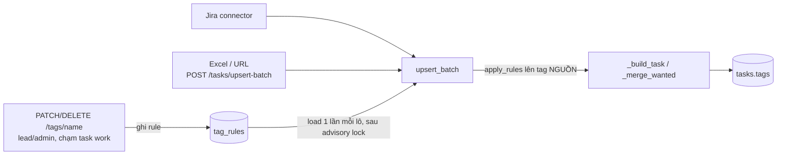

# Spec: Ghi nhớ tag đã đổi tên/xoá khi đồng bộ (Tag Rules, T7)

- Trạng thái: CHỐT (User duyệt Q1-Q6 ngày 2026-10-16, xem mục 8)
- Tác giả: architect
- Ngày: 2026-10-16
- Nhánh: `feat/T7-tag-rules`, worktree `../ai_assistant_personal-T7`
- Alembic head lúc viết spec: `a4d7e1c9b3f5` (add local password login). Backend-dev kiểm lại bằng `alembic heads` trước khi đặt `down_revision`.
- Phụ thuộc: T6 (PR #58, đã merge): `api/v1/tags.py`, `services/tag_service.py`, `schemas/tag.py`.

## 1. Bối cảnh & phạm vi

**Vấn đề.** T6 cho đổi tên/xoá tag hàng loạt. Nhưng `task_sync_service._merge_wanted` gộp `union(tag hiện có, tag từ nguồn)`, và `jira_mapping.map_issue` sinh tag từ `jira`, project key, loại issue, custom field phân nhóm, parent, components, fixVersions, labels. Lần sync kế tiếp tag cũ quay lại: đổi `bug` thành `defect` thì task có cả hai; xoá `sprint-12` thì nó hiện lại. Hệ thống không nhớ quyết định của User.

**Giải pháp.** Bảng `tag_rules` lưu quyết định: `source_tag -> target_tag` (alias) hoặc `source_tag -> NULL` (chặn). Rule được ghi tự động khi đổi tên/xoá tag chạm task `work`, và được áp lên **tag đến từ nguồn ngoài** trong `upsert_batch` trước bước gộp. Tag đang có trên task và tag User tự gõ không bị rule đụng tới.



**In-scope**
- Bảng `tag_rules` + model + migration có downgrade.
- `tag_rule_service` (đọc, áp, ghi, xoá rule), gọi từ `tag_service` và `task_sync_service`.
- Áp rule trong `upsert_batch` cho cả task mới (`_build_task`) và task đã có (`_wanted_values` -> `_merge_wanted`). Vì Jira connector, Excel và URL đều đi qua `upsert_batch` nên cả ba được phủ.
- API: `GET /api/v1/tag-rules` (phân trang), `DELETE /api/v1/tag-rules/{rule_id}` (gỡ chặn). `TagChangeResponse` thêm trường `rule`.
- Audit: ghi `audit_log` khi rule được đặt hoặc bị gỡ.
- Web (chế độ `DATA_SOURCE=api`): trên `/tags` hiện danh sách rule và nút gỡ; sau khi đổi tên/xoá thì báo đã ghi nhớ. Phần này **cần mở rộng phạm vi T7** (xem Q1).
- Pytest, `docs/API_REFERENCE.md`.

**Out-of-scope**
- Tạo rule thủ công (`POST /tag-rules`, chặn trước một tag chưa có trên task nào). Để epic sau nếu cần.
- Áp rule cho nhập JSON sao lưu (`POST /import/datafile`, `import_service`): đây là khôi phục dữ liệu, phải giữ nguyên bản gốc.
- Áp rule lên tag hiện có trong DB (dọn dữ liệu cũ), lên task trong thùng rác, hay khi khôi phục task từ thùng rác.
- Chế độ `DATA_SOURCE=file/memory` (`lib/store/engine.ts`, `jira-actions.ts` chế độ file): không có rule. Hạn chế đã biết, ghi vào docs.
- Rule theo team/nhóm (hệ thống hiện chỉ có một team, không có bảng `teams`), rule cho note/task personal.
- Sửa lỗi có sẵn: `_merge_wanted` có thể cho ra hơn `MAX_TAGS` tag (xem rủi ro R4).
- `scripts/smoke-test.sh` (cần Docker local). Thay bằng pytest trên VM dev.

## 2. Thiết kế và thay đổi dữ liệu

### 2.1 Phạm vi rule: TOÀN CỤC (cả instance = cả team)

| Phương án | Đánh giá |
|---|---|
| Theo user | Sai mô hình: task `work` dùng chung, một task chỉ có một mảng `tags`. Sync chạy một lần cho cả team, không biết áp rule của ai. Hai lead có rule khác nhau sẽ làm tag nhảy qua lại mỗi lần sync. |
| Theo team | Đúng ý nghĩa, nhưng hệ thống chưa có khái niệm team (không có bảng `teams`, mọi task `work` thuộc một team chung). Thêm cột `team_id` lúc này là cột luôn cùng một giá trị. |
| **Toàn cục (chọn)** | Khớp thực tế: một instance = một team. Rule chỉ ảnh hưởng tag nguồn ngoài ghi vào task `work`, mà `upsert_batch` chỉ ghi task `work` (task `personal` trùng khoá bị bỏ qua, đếm `skipped_personal`). Quyền ghi rule = quyền sửa tag hàng loạt trên task work (`task:write_any_work`). |

Hệ quả:
- Chỉ user có `task:write_any_work` (lead, admin) **tạo** được rule, và chỉ khi lệnh đổi tên/xoá thực sự đổi ít nhất một task `scope=work`. Member đổi tên tag trên note/task personal của mình không sinh rule.
- Note và task `personal` không bao giờ bị rule ảnh hưởng (không có đường sync nào ghi vào chúng).
- Khi có team thật, thêm cột `team_id` nullable và đổi unique thành `(team_id, source_tag)` bằng migration mới; dữ liệu hiện tại thành rule của team mặc định.

### 2.2 Bảng `tag_rules`

| Cột | Kiểu | Null | Ghi chú |
|---|---|---|---|
| `id` | `uuid` PK | no | `UUIDPrimaryKeyMixin` |
| `source_tag` | `varchar(64)` | no | Tag từ nguồn ngoài cần đổi/chặn. Đã chuẩn hoá bằng `normalize_tags`. |
| `target_tag` | `varchar(64)` | **yes** | Tag thay thế. `NULL` = chặn (tag đã bị xoá). |
| `created_by_user_id` | `uuid` FK `users.id` `ON DELETE SET NULL` | yes | Người tạo/cập nhật rule gần nhất. Xoá user không được kéo theo mất rule. |
| `created_at`, `updated_at` | `timestamptz` | no | `TimestampMixin`. `updated_at` đổi khi rule bị viết lại (làm phẳng chuỗi, đổi đích). |

| Constraint / Index | Định nghĩa | Vì sao |
|---|---|---|
| `uq_tag_rules_source_tag` | `UNIQUE (source_tag)` (không partial) | Một tag nguồn chỉ có một quyết định. Rule xoá cứng, không có `deleted_at`, nên không cần partial. Ghi rule bằng `INSERT ... ON CONFLICT (source_tag) DO UPDATE`. |
| `ix_tag_rules_target_tag` | `INDEX (target_tag)` | Bước làm phẳng chuỗi `UPDATE ... WHERE target_tag = :old`. Bảng nhỏ nhưng index rẻ. |
| `ck_tag_rules_source_not_blank` | `length(source_tag) > 0 AND source_tag = btrim(source_tag)` | Lưới an toàn cuối. |
| `ck_tag_rules_target_not_blank` | `target_tag IS NULL OR (length(target_tag) > 0 AND target_tag = btrim(target_tag))` | Như trên. |
| `ck_tag_rules_not_self` | `target_tag IS NULL OR target_tag <> source_tag` | Chặn vòng một bước ở tầng DB. |

**Chuẩn hoá.** Mọi giá trị ghi vào `source_tag`/`target_tag` đi qua `tag_service.normalize_name` (tức `normalize_tags`: `strip`, `lower`, space -> `-`, tối đa 64 ký tự), cùng hàm mà `TaskUpsert` dùng cho tag nguồn. Nhờ vậy so khớp rule là so chuỗi chính xác. **Không** đặt CHECK `source_tag = lower(source_tag)` trong DB: `str.lower()` của Python và `lower()` của Postgres (phụ thuộc collation) khác nhau với một số ký tự Unicode, CHECK đó có thể từ chối tag hợp lệ. Chuẩn hoá chỉ ở một chỗ (service), DB chỉ chặn chuỗi rỗng/có khoảng trắng đầu cuối.

**Bất biến "phẳng" (flattened).** Không `target_tag` nào đồng thời là `source_tag` của rule khác. Nhờ vậy:
- Áp rule chỉ cần tra **một bước**, không phải duyệt chuỗi khi sync, và áp hai lần vẫn ra cùng kết quả (idempotent).
- Không thể có vòng (`a -> b -> a`).

Bất biến được giữ ở bước ghi (mục 2.4), không ở bước đọc.

### 2.3 Migration

- File mới trong `apps/core/migrations/versions/`, tên theo `file_template` của `alembic.ini` (`YYYY_MM_DD_HHMM-<rev>_add_tag_rules.py`), `down_revision = "a4d7e1c9b3f5"` (kiểm lại head). Máy local không có Docker nên viết tay theo mẫu migration gần nhất; docstring ghi `Spec: docs/specs/tag-rules.md`.
- `upgrade`: `create_table("tag_rules", ...)` với đủ constraint ở 2.2, rồi `create_index("ix_tag_rules_target_tag", ...)`. Bảng mới, không backfill, không khoá bảng hiện có.
- `downgrade`: `drop_index` rồi `drop_table`. **Mất toàn bộ rule**: sau khi hạ, lần sync kế tiếp tag đã đổi tên/xoá quay lại như trước T7. Không mất dữ liệu task/note. Dump trước khi hạ trên dữ liệu thật: `pg_dump -t tag_rules`.
- Model `apps/core/app/models/tag_rule.py` khai đúng constraint/index trong `__table_args__` (tên ngắn, để naming convention ghép `ck_tag_rules_...`) để `alembic check` không báo drift; đăng ký trong `models/__init__.py`.
- `AuditAction` thêm `TAG_RULE_SET = "tag_rule_set"`, `TAG_RULE_DELETED = "tag_rule_deleted"`. Cột `audit_log.action` cố ý không có CHECK nên không cần migration cho phần này.

### 2.4 Ghi rule (trong `tag_service`)

`tag_service._apply(session, user, old, new)` đổi như sau (thứ tự bắt buộc):

1. Nếu `user.has(TASK_WRITE_ANY_WORK)`: gọi `locks.take_import_write_lock(session)` **trước** các câu `UPDATE`. Lý do: `upsert_batch` lấy cùng advisory lock rồi mới đọc rule và khoá dòng task. Lấy khoá ở đây (a) tuần tự hoá đổi tên với lô sync nên lô không đọc rule cũ rồi ghi đè sau khi đổi tên xong; (b) giữ cùng thứ tự khoá (advisory -> dòng) với sync, tránh deadlock. Chờ quá 5s thì 409 như sync. Member không lấy khoá (không chạm task work).
2. `UPDATE tasks ... RETURNING id, scope` (thêm `scope` vào `RETURNING` của nhánh `Task`). Đếm số task `work` bị đổi.
3. Nếu có ít nhất một task `work` bị đổi, gọi `tag_rule_service.record_change(session, user, old, new)`:
   - (a) **Hồi sinh đích** (chỉ khi đổi tên): `DELETE FROM tag_rules WHERE source_tag = :new`. User vừa chủ động chọn `new` làm tên tag, nên mọi rule cũ đổi/chặn `new` hết hiệu lực. Nếu không xoá, lần sync sau tag Jira `new` lại bị đổi đi trong khi task đang mang `new`.
   - (b) **Làm phẳng chuỗi**: `UPDATE tag_rules SET target_tag = :new, updated_at = now() WHERE target_tag = :old` (`:new` là `NULL` nếu xoá). Ví dụ có `x -> old`, nay `old -> new` thì `x -> new`; nay xoá `old` thì `x` bị chặn.
   - (c) **Ghi rule chính**: `INSERT (source_tag=:old, target_tag=:new, created_by_user_id) ON CONFLICT (source_tag) DO UPDATE SET target_tag, created_by_user_id, updated_at`.
   - Ghi `audit_log` `TAG_RULE_SET`, `target_type="tag_rule"`, `target_id=rule.id`, `details={"source_tag", "target_tag", "revived": [<source đã xoá ở (a)>], "rewired": <số dòng ở (b)>}`.
   - Bước (a) chạy trước (b) là điều kiện để bất biến phẳng đúng: nếu đã có `new -> old` thì (a) xoá nó, (b) không thể sinh `new -> new`.
4. `TagChangeResponse.rule` = rule vừa ghi (hoặc `None`).

**Bảng tình huống** (bắt đầu từ rule rỗng):

| Hành động lần lượt | Rule sau cùng | Tag Jira `a` sync vào thành |
|---|---|---|
| đổi `a -> b` | `a -> b` | `b` |
| đổi `a -> b`, rồi `b -> c` | `a -> c`, `b -> c` | `c` |
| đổi `a -> b`, rồi `b -> a` | `b -> a` (rule `a -> b` bị hồi sinh xoá) | `a` |
| đổi `a -> b`, rồi xoá `b` | `a -> NULL`, `b -> NULL` | (bị bỏ) |
| xoá `a`, rồi đổi `z -> a` | `z -> a` (rule chặn `a` bị hồi sinh xoá) | `a` |
| xoá `a`, rồi gỡ rule qua `DELETE /tag-rules/{id}` | rỗng | `a` (quay lại ở lần sync sau) |
| member đổi `a -> b` trên note/task personal | không đổi | như trước |
| lead đổi `a -> b` nhưng `a` chỉ có trên note/task personal | không đổi | như trước |

**Khôi phục (gỡ chặn).** Ba đường: (1) `DELETE /tag-rules/{id}` (UI nút "Gỡ"); (2) đổi tên một tag khác thành chính tag đó (hồi sinh tự động, bước 3a); (3) không có đường nào khác. Gõ tay tag bị chặn vào form task **không** gỡ rule (xem 2.5).

### 2.5 Áp rule (trong `task_sync_service.upsert_batch`)

Hàm thuần dùng chung trong `services/tag_rule_service.py`:

```python
TagRules = Mapping[str, str | None]  # source_tag -> target_tag (None = chặn)

def apply_rules(tags: Sequence[str], rules: TagRules) -> list[str]:
    """Đổi/bỏ tag NGUỒN theo rule; giữ thứ tự, bỏ trùng sau khi đổi. Không chạm DB."""

async def load_rules(session: AsyncSession) -> dict[str, str | None]:
    """Một câu SELECT toàn bảng; bảng nhỏ (mỗi lần đổi tên/xoá thêm tối đa một dòng)."""
```

Điểm gọi trong `upsert_batch`:
- Ngay **sau** `locks.take_import_write_lock(session)` (để thấy rule mới nhất và không xen với đổi tên): `rules = await tag_rule_service.load_rules(session)`.
- Thêm trường `tags: list[str]` vào `_Prepared`; gán `p.tags = apply_rules(p.item.tags, rules)` cho mọi item. **Không** sửa `p.item` (TaskUpsert là input của client).
- `_build_task` dùng `p.tags` thay cho `item.tags`.
- `_wanted_values` dùng `p.tags` cho khoá `"tags"` (khi `"tags" in sent`). `_merge_wanted` giữ nguyên ngữ nghĩa union: `union(task.tags, p.tags)`. Tag đang có trên task KHÔNG bị lọc.
- Đếm số item có tag bị đổi/bỏ, ghi vào dòng `logger.info("upsert-batch: ...")` (`tag_rules_applied=%d`). Không thêm trường vào `TaskUpsertResult` (tránh đổi hợp đồng web).

Hệ quả cần biết:
- Không đổi tag thì `diff` rỗng, sync hai lần vẫn no-op (giữ tính idempotent hiện có).
- Rule áp sau khi `jira_mapping` đã cắt còn `MAX_TAGS`: tag bị chặn chiếm chỗ trong 20 tag đầu nên có thể làm mất label đứng sau. Chấp nhận ở v1 (xem Q4); `jira_mapping.py` chỉ sửa comment dòng ~384 ("tags (gộp, sau khi áp tag_rules)").

**Tag User tự gõ: KHÔNG bị chặn.** Rule chỉ áp cho tag đến từ nguồn ngoài trong `upsert_batch`. `POST/PATCH /tasks`, `/notes`, nhập JSON sao lưu không đọc rule. Lý do: rule là "nhớ quyết định để sync không phá", không phải chính sách cấm tag; chặn nhập tay sẽ gây lỗi khó hiểu ("tôi gõ `bug` mà mất") và buộc kiểm quyền lead cho thao tác của member. Tag gõ tay nằm trong `task.tags` nên union giữ nó, sync không xoá.

## 3. API contract

Prefix `/api/v1`. Router mới `api/v1/tag_rules.py`, prefix `/tag-rules`, đăng ký trong `api/v1/router.py`. Cố ý **không** đặt dưới `/tags/rules`: `/tags/{name:path}` (PATCH/DELETE) nuốt mọi đường con, `DELETE /tags/rules/<id>` sẽ bị hiểu là xoá tag tên `rules/<id>`.

| Method | Path | Request | Response | Lỗi |
|---|---|---|---|---|
| `GET` | `/tag-rules` | Query `limit` (1..200, mặc định 50), `offset` (>=0, mặc định 0) | `Page[TagRuleRead]`, sắp theo `source_tag` | 401 |
| `DELETE` | `/tag-rules/{rule_id}` | `rule_id: UUID` | 204 | 401; 403 thiếu `task:write_any_work`; 404 không có rule; 422 id sai định dạng |
| `PATCH` | `/tags/{name}` (T6, đổi) | như cũ | `TagChangeResponse` thêm `rule` | như cũ; thêm 409 khi chờ khoá sync quá 5s |
| `DELETE` | `/tags/{name}` (T6, đổi) | như cũ | `TagChangeResponse` thêm `rule` | như cũ; thêm 409 như trên |

Pydantic (`schemas/tag.py`):

```python
class TagRuleRead(BaseModel):
    model_config = ConfigDict(from_attributes=True)
    id: uuid.UUID
    source_tag: str
    target_tag: str | None = Field(description="NULL = tag bị chặn (đã xoá)")
    created_by_user_id: uuid.UUID | None
    created_by_name: str | None = Field(description="users.name; NULL nếu user đã bị xoá")
    created_at: datetime
    updated_at: datetime

    @computed_field
    def kind(self) -> Literal["alias", "block"]: ...

class TagChangeResponse(BaseModel):
    tasks: int
    notes: int
    rule: TagRuleRead | None = Field(
        default=None,
        description="Rule đồng bộ vừa ghi; NULL nếu lệnh không chạm task work",
    )
```

- `GET /tag-rules`: mọi user đã đăng nhập đọc được (rule ảnh hưởng task `work` mà ai cũng thấy; member cần biết vì sao tag Jira không hiện). `created_by_name` lấy bằng `LEFT JOIN users`, không trả email.
- `DELETE /tag-rules/{rule_id}`: `dependencies=[Depends(require_permission(Permission.TASK_WRITE_ANY_WORK))]`. Xoá cứng, ghi `audit_log` `TAG_RULE_DELETED` với `details={"source_tag", "target_tag"}`. Không lấy advisory lock (gỡ rule chỉ làm tag quay lại, đua với sync không gây hại). Không đụng `tasks`.

## 4. Thay đổi Web (chế độ `DATA_SOURCE=api`; cần User mở rộng phạm vi T7, Q1)

- Route `/tags` (`app/tags/page.tsx`): tải song song `getTagsStatsApi()` và `getTagRulesApi({ page })` bằng `Promise.all`; thêm khối "Quy tắc đồng bộ" bên dưới `TagManager`. Ở chế độ file/memory khối này ẩn (không có rule). Phân trang server-side qua `?rulesPage=` (50/trang, Trước/Sau, "Trang x / y", "Tổng: n") theo `comment-style.md`; thực tế ít khi quá một trang.
- Component mới `components/tag-rule-list.tsx` (client): mỗi dòng `#source -> #target` hoặc `#source (đã chặn)`, người tạo, ngày (format qua `lib/format.ts` với `tz` tường minh). Nút "Gỡ" chỉ hiện khi user có `task:write_any_work` (page truyền cờ xuống từ `getMe`); `confirm` nói rõ "lần đồng bộ tới tag này sẽ quay lại".
- `components/tag-manager.tsx`: sau khi đổi tên/xoá thành công, nếu kết quả có `rule` thì hiện thông báo một dòng "Đã ghi nhớ: Jira/Excel đồng bộ sẽ đổi #a thành #b" (hoặc "sẽ bỏ #a"), rồi `router.refresh()` để khối rule cập nhật. Sửa thông điệp `confirm` xoá tag cho đúng.
- `lib/api.ts` (mục Tags): `getTagRulesApi`, `deleteTagRuleApi`; `renameGlobalTagApi`/`deleteGlobalTagApi` trả `TagChangeResult` (gồm `rule`) thay vì `void`. Kiểu viết tay trong `api.ts` theo cách T6 làm với `CoreTagStat` (snake_case -> camelCase), vì không chạy được `make gen-types` khi không có Docker. Không sửa tay `lib/generated/**`.
- `app/actions.ts`: `renameTagAction`/`deleteTagAction` trả thêm `rule`; action mới `deleteTagRuleAction(ruleId)` mở đầu bằng `requirePermission("task:write_any_work")` (test tĩnh `tests/server-actions-guard.test.ts` bắt thiếu guard), gọi `revalidateAll()`.
- Kiểm `lib/core-cache.ts`: GET `/api/v1/tag-rules` có cache thì phải bị xoá bởi `revalidateAll()` sau rename/delete/gỡ rule.

## 5. Ownership (không agent nào sửa file của agent khác)

**backend-dev** (theo phạm vi T7 hiện có, cộng các file nêu rõ dưới đây):
- `apps/core/app/models/tag_rule.py` (mới), `apps/core/app/models/__init__.py`, `apps/core/app/models/enums.py` (chỉ thêm 2 giá trị `AuditAction`)
- `apps/core/migrations/versions/<new>_add_tag_rules.py` (mới)
- `apps/core/app/schemas/tag.py`
- `apps/core/app/services/tag_rule_service.py` (mới), `apps/core/app/services/tag_service.py`, `apps/core/app/services/task_sync_service.py`, `apps/core/app/services/jira_mapping.py` (chỉ comment)
- `apps/core/app/api/v1/tag_rules.py` (mới), `apps/core/app/api/v1/router.py` (một dòng include)
- `apps/core/tests/test_tag_rules.py` (mới), `apps/core/tests/test_tag_api.py` (sửa 4 assert so sánh bằng `{"tasks", "notes"}`)
- `docs/API_REFERENCE.md` (mục 2b, đoạn "Cạnh tranh với Jira sync", ghi chú upsert-batch ở dòng ~151/157)

**frontend-dev** (cần mở rộng phạm vi T7, Q1):
- `apps/web/app/tags/page.tsx`, `apps/web/components/tag-manager.tsx`, `apps/web/components/tag-rule-list.tsx` (mới)
- `apps/web/lib/api.ts` (chỉ mục `// ── Tags Management`), `apps/web/app/actions.ts` (chỉ khối tag ở dòng ~772-796)

**orchestrator**: `docs/specs/tag-rules.md`, `task-board.sh coord T7` để mở rộng phạm vi (web, `models/enums.py`, `api/v1/router.py`, `schemas/tag.py`), handoff. Spec trong `docs/specs/` không đăng ký trong `apps/web/lib/docs.ts` (không spec cũ nào được đăng ký), nên không cần sửa `docs.ts`.

**Thứ tự:** backend-dev trước (hợp đồng mục 3 cố định nên frontend-dev có thể code song song ở worktree riêng, nhưng chỉ kiểm chứng được khi backend đã lên VM dev). Đề xuất tuần tự: backend -> `db-reviewer` (migration) -> deploy nhánh lên VM dev -> frontend -> `code-reviewer` -> `security-auditor` (chạm Server Action và quyền).

## 6. Tiêu chí nghiệm thu (kiểm chứng được)

Máy local không có Docker; chưa có target `make devvm-test`/`make devvm-smoke` (T8 chưa làm). Kiểm backend bằng script ở `scripts/patches/`:

- [ ] `bash scripts/patches/dev-vm-backend-test.sh` pass toàn bộ: ruff check, `alembic heads` đúng 1 head, `upgrade head -> downgrade -1 -> upgrade head`, `alembic check` không drift, pytest toàn bộ.
- [ ] `bash scripts/patches/dev-vm-backend-test.sh -k "tag"` pass, gồm test mới trong `tests/test_tag_rules.py`:
  - Hàm thuần `apply_rules`: alias, chặn, giữ thứ tự, bỏ trùng sau đổi (`[a, b]` với `a -> b` ra `[b]`), tag không có rule giữ nguyên, danh sách rỗng.
  - Lead đổi `a -> b` trên task work: response `rule = {source_tag: "a", target_tag: "b", kind: "alias"}`; `POST /tasks/upsert-batch` gửi lại task đó với `tags: ["a"]` thì task chỉ có `b`; task mới gửi `["a", "x"]` được tạo với `["b", "x"]`.
  - Lead xoá `x`: rule chặn; upsert gửi `["x"]` thì không có `x`; gửi lại lần hai trả `unchanged` (no-op, không sinh `TaskEvent`).
  - Chuỗi và vòng: các dòng của bảng tình huống ở mục 2.4 (a->b->c, a->b rồi b->a, xoá a rồi đổi z->a). Kiểm sau mỗi bước không có `target_tag` nào là `source_tag`.
  - Member đổi tên trên task personal/note: không có rule; lead đổi tag chỉ có trên note: không có rule (`rule` là `null`).
  - Tag gõ tay không bị chặn: sau khi chặn `x`, `PATCH /tasks/{id}` với `tags: ["x"]` thành công; upsert sau đó vẫn giữ `x` trên task đó (union).
  - Task `personal` trùng khoá vẫn `skipped_personal`, tag không đổi.
  - `GET /tag-rules`: member đọc được, phân trang `limit/offset/total` đúng; `DELETE` bởi member 403, bởi lead 204 rồi upsert đưa `a` quay lại; id không tồn tại 404; có dòng `audit_log` `tag_rule_deleted` và `tag_rule_set`.
  - Đường Jira connector: nếu `tests/` đã có fixture giả Jira cho `integration_sync_service`, thêm một ca kiểm label bị chặn không quay lại; không có thì đường upsert-batch là đủ (cùng hàm `upsert_batch`).
- [ ] `cd apps/web && npx tsc --noEmit && npm run lint && npm test` pass (gồm `server-actions-guard`).
- [ ] Kịch bản tay trên VM dev (`DATA_SOURCE=api`, user lead), sau khi deploy nhánh: (1) chọn một tag đến từ label Jira, đổi tên ở `/tags`, thấy thông báo "đã ghi nhớ"; (2) bấm đồng bộ kết nối Jira ở `/data`; (3) `/tags` không còn tag cũ, số task của tag mới không giảm; (4) gỡ rule ở khối "Quy tắc đồng bộ", đồng bộ lại thì tag cũ quay lại. Đăng nhập member: thấy danh sách rule, không thấy nút "Gỡ".
- [ ] `docs/API_REFERENCE.md` mô tả `/tag-rules`, trường `rule`, và bỏ cảnh báo "chỉ có tác dụng tạm thời".

## 7. Rủi ro & câu hỏi cần User chốt

**Rủi ro**
- **R1 Dữ liệu cũ.** Tag đã đổi tên/xoá bằng T6 trước khi T7 lên không có rule, nên sẽ quay lại ở lần sync tới. Cách xử lý: sau khi deploy, lead đổi tên/xoá lại các tag đó một lần (lệnh tạo rule). Không có cách suy ngược đáng tin từ `task_events` (payload `{tags: {from, to}}` có, nhưng không biết lệnh đó có chạm task work hay không và thứ tự với các thay đổi sau). Xem Q3.
- **R2 Hiệu năng sync.** Mỗi lô thêm một `SELECT` toàn bảng `tag_rules` và một vòng dict trên tag của mỗi item; với vài trăm rule là không đáng kể so với `FOR UPDATE` và flush. Đổi tên/xoá tag của lead giờ phải chờ advisory lock: nếu đúng lúc đang sync lô lớn, request có thể 409 sau 5s; UI hiện lỗi "thử lại" sẵn có.
- **R3 MAX_TAGS.** Rule áp sau khi `jira_mapping` cắt còn 20, nên issue nhiều label có thể mất label đứng sau tag bị chặn (Q4). Rule không bao giờ làm tăng số tag (đổi 1-1 hoặc bỏ).
- **R4 Lỗi có sẵn, ngoài phạm vi.** `_merge_wanted` cho ra `union(tag cũ, tag nguồn)` mà không cắt `MAX_TAGS`; task có thể vượt 20 tag và khi User sửa task, `TaskUpdate` (normalize_tags) báo lỗi "tối đa 20 tag". T7 không làm tệ hơn (alias còn làm giảm trùng). Nên mở task riêng.
- **R5 Rule ngoài ý muốn.** Lead xoá tag định danh (`jira`, project key) sẽ chặn nó vĩnh viễn với mọi task sync. Đây là đúng ý lệnh, có nút gỡ, có audit.
- **R6 Chế độ file.** `DATA_SOURCE=file` không có rule; tag quay lại như cũ. Ghi rõ trong docs.

**Câu hỏi cần User chốt**
- **Q1 Phạm vi T7.** Dòng T7 trong `TASKS.md` chỉ có file backend và `docs/API_REFERENCE.md`. Spec đề xuất thêm: web (`apps/web/app/tags/page.tsx`, `components/tag-manager.tsx`, `components/tag-rule-list.tsx` mới, mục Tags trong `lib/api.ts`, khối tag trong `app/actions.ts`) và các file backend dùng chung `models/enums.py`, `api/v1/router.py`, `schemas/tag.py`. Đồng ý mở rộng trong T7, hay tách web thành task riêng (khi đó tạm thời chỉ gỡ rule được qua API)?
- **Q2 Phạm vi rule toàn cục**, chỉ lead/admin (`task:write_any_work`) tạo/gỡ, member chỉ xem: đồng ý?
- **Q3 Dữ liệu cũ (R1)**: chấp nhận lead làm lại thao tác đổi tên/xoá sau deploy, hay cần script một lần trong `scripts/patches/` dựng rule từ `task_events`?
- **Q4 Áp rule trước khi cắt 20 tag (R3)**: v1 chỉ áp trong `upsert_batch` (đề xuất). Có cần áp thêm trong `jira_mapping.map_issue` trước bước cắt (phải truyền rule vào hàm thuần, sửa `integration_sync_service`) không?
- **Q5 Excel/URL** (`POST /tasks/upsert-batch`) cũng bị áp rule như Jira (đề xuất: có, cùng một đường code, và Excel thường là bản xuất từ Jira). Đồng ý?
- **Q6 Tag gõ tay không bị chặn** (đề xuất mục 2.5): đồng ý?

## 8. Quyết định đã chốt (User, 2026-10-16)

User đồng ý theo đề nghị. Phần này THẮNG mọi chỗ khác trong spec nếu mâu thuẫn.

- **Q1** Mở rộng phạm vi T7 sang web và các file backend dùng chung (đã ghi `task-board.sh coord T7`).
- **Q2** Rule toàn cục theo instance; chỉ lead/admin (`task:write_any_work`) tạo và gỡ; member chỉ xem.
- **Q3** Không viết script dựng rule từ `task_events`. Sau deploy, lead tự đổi tên/xoá lại các tag cũ một lần (ghi vào handoff và docs).
- **Q4** **Áp rule TRƯỚC bước cắt `MAX_TAGS`** (thay cho đề xuất v1 "chỉ trong upsert_batch"):
  - `jira_mapping.map_issue` nhận thêm tham số tuỳ chọn `tag_rules` (mặc định `None` = hành vi cũ, giữ hàm thuần), áp `apply_rules` lên danh sách tag đã sắp xếp NGAY TRƯỚC khi cắt còn 20, rồi mới cắt.
  - `integration_sync_service` nạp rule MỘT lần mỗi lần chạy sync và truyền xuống `map_issue`.
  - `upsert_batch` vẫn áp rule lần nữa (idempotent) để phủ Excel/URL, cũng trước khi gộp vào tag của task.
  - Sửa comment ở `jira_mapping.py` ~dòng 384 cho khớp.
- **Q5** Excel/URL (`POST /tasks/upsert-batch`) bị áp rule như Jira.
- **Q6** Tag người dùng tự gõ trong form không bị chặn.
- **T9** (task riêng, sau T7): lỗi `_merge_wanted` không cắt `MAX_TAGS` và các điểm review T6 còn tồn.
- **Kiểm chứng backend** (máy không có Docker): `make devvm-test`, `make devvm-smoke`, và nếu cần xem API thật `make devvm-branch BRANCH=feat/T7-tag-rules TASK=T7` (nhánh CÓ migration nên script sẽ từ chối: thử migration bằng `devvm-smoke`, không dùng `--allow-migration` khi chưa hỏi User).
