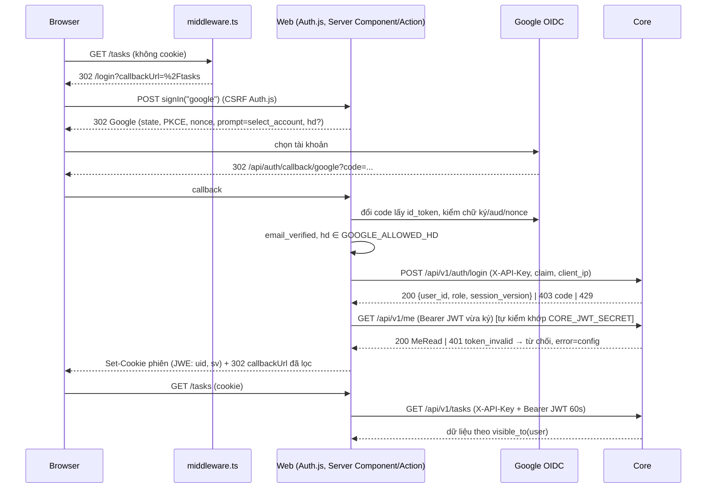

# Spec: Đăng nhập Google ở Web bằng Auth.js (NextAuth v5)

- Trạng thái: **CHỐT** (User chốt 2026-10-13: Q1-Q14 theo khuyến nghị. Yêu cầu thêm: tối ưu số lần gọi API, tận dụng React (Suspense, streaming, `useOptimistic`, `useTransition`) cho trải nghiệm mượt, xem mục 4.12)
- Tác giả: architect
- Ngày: 2026-10-13
- Nhánh lúc viết: `feat/auth-multiuser` (HEAD `55f5865`, working tree còn nhiều file sửa chưa commit: gỡ mật khẩu nhập, gỡ múi giờ theo user)
- Spec cha (CHỐT): `docs/specs/auth-multiuser.md`. Spec này chi tiết hoá phần **web** (mục 5, 8.2, 9.3 của spec cha) theo code core **hiện tại**.
- Thay thế: `docs/specs/auth-web-p2.md` (DRAFT cùng ngày, viết trước khi gỡ múi giờ theo user; còn nhắc `PUT /me/timezone`, `/settings/timezones`, `TimezoneSelector`). Xem Q1 và Phụ lục A.
- Đã đối chiếu code: `apps/core/app/core/{auth,permissions,security,rate_limit,config}.py`, `api/v1/{auth,me,router,settings,tasks}.py`, `schemas/{auth,user,task}.py`, `services/errors.py`, `main.py`, `cli/auth.py`; `apps/web/lib/{api,core-cache,nav,excel-upsert,vault/store}.ts`, `lib/store/types.ts`, `app/*actions*.ts`, `app/layout.tsx`, `app/data/page.tsx`, `app/api/export/route.ts`, `next.config.ts`, `package.json`/lock (`next@15.5.25`), `docker-compose*.yml`, `scripts/gen-env.sh`, `.env.example`.

## 1. Bối cảnh & phạm vi

### 1.1. Vấn đề

Core đã đòi `X-API-Key` + `Authorization: Bearer <JWT HS256>` cho mọi `/api/v1/*` trừ `POST /auth/login`. Web chưa có Auth.js, chưa ký JWT, Server Action chưa kiểm phiên, nên ở `DATA_SOURCE=api` mọi trang nhận 401. Web còn gọi `GET/PUT /settings/current-users` (đã gỡ ở core). Rào chống rò cache hiện tại (`perUser` trong `coreFetch`) chỉ nhìn header do **caller** truyền, nên sẽ không bắt được token nếu token được gắn bên trong `coreFetchRaw` (Phụ lục A4).

### 1.2. In-scope (chỉ `DATA_SOURCE=api`, trừ khi ghi khác)

1. Auth.js v5, provider Google, invite-only qua core, `hd` allowlist.
2. Web ký JWT ngắn hạn theo từng người, gắn ở **một chỗ** (`coreFetch`).
3. Rào cache dùng chung theo danh tính (`uid:sv`) và test khoá hành vi.
4. `middleware.ts` (lớp UX), kiểm phiên + quyền ở **từng** Server Action và route handler.
5. Xử lý 401/403/hết phiên ở trang và ở action.
6. `getMe()`, nav và UI ẩn/hiện theo `permissions`, `can_edit`/`can_delete`.
7. Gỡ `/settings/current-users` ở nhánh api; "việc của tôi" do core suy từ JWT, alias đọc từ `/me`.
8. `/me` (hồ sơ chỉ đọc), `/login`, `/auth/expired`, trang lỗi cấu hình.
9. Két (Vault) tách file theo user; `/api/export` có kiểm phiên.
10. Hành vi rõ ràng ở `DATA_SOURCE=file|memory` (không auth, chỉ dev).
11. Biến môi trường mới và nơi khai báo.

### 1.3. Out-of-scope

- Thay đổi schema Postgres. Không migration.
- Đưa lại `X-Import-Secret`/`IMPORT_COMMIT_SECRET` hay múi giờ theo user: **không**. Múi giờ là `DISPLAY_TZ` (biến `TZ` của server).
- Trang quản trị `/admin/users`, `/admin/audit` (P3-web, đợi backend `/api/v1/admin/*`, hiện **chưa có** trong `router.py`).
- Caddy, DNS, chứng chỉ, `ufw` (giai đoạn đầu: `localhost` + SSH tunnel theo `docs/STAGING_DOMAIN_HTTPS.md`).
- RLS, token Jira theo user, step-up auth (P4).

### 1.4. Luồng tổng



## 2. Thay đổi dữ liệu

Không thay đổi Postgres.

| Đối tượng | Thay đổi | Ràng buộc | Migration / rollback |
|---|---|---|---|
| Cookie phiên Auth.js | Mới. JWE (khoá `AUTH_SECRET`) chỉ chứa `uid`, `sv` và claim chuẩn (`iat`, `exp`, `jti`) | `HttpOnly`, `SameSite=Lax`, `Secure` + tiền tố `__Secure-` khi `AUTH_URL` là https | Đổi `AUTH_SECRET` = thu hồi mọi phiên web |
| `DATA_DIR/vault.json` | Ở api: `vault-<uid>.json` mỗi user | `uid` lấy từ phiên, khớp regex UUID trước khi ghép đường dẫn, không bao giờ từ input client | Runbook một lần: `vault.json` → `vault-<owner_id>.json` (spec cha 7.3). Rollback: đổi tên ngược. Local giữ `vault.json` |

## 3. API contract

### 3.1. Endpoint core web dùng (đã có, không đổi)

| Method | Path | Xác thực | Request | Response | Lỗi web phải xử lý |
|---|---|---|---|---|---|
| POST | `/api/v1/auth/login` | chỉ `X-API-Key` | `LoginRequest { google_sub, email, email_verified, name?, hd?, client_ip? (≤45) }`, `extra="forbid"` (gửi field thừa là 422) | `LoginResult { user_id, role, session_version }` | 403 `code ∈ {not_invited, disabled, email_unverified, hd_not_allowed, account_mismatch}`; 429; 422 |
| GET | `/api/v1/me` | Bearer | | `MeRead { id, email, name, role, status, effective_timezone, aliases[{source, alias}], permissions[] }` | 401 `token_invalid` / `user_inactive` |
| mọi route khác | | Bearer | | | bảng 3.4 |

Không còn: `/me/timezone`, `/settings/timezones`, `/settings/display-timezone`, `/settings/current-users`, `/import/verify-secret`.

### 3.2. JWT web → core (khớp `core/auth.py`)

- `HS256`, khoá `CORE_JWT_SECRET` (web từ chối chạy nhánh api nếu < 32 ký tự).
- Claim đúng 7: `iss="builder-web"`, `aud="builder-core"`, `sub=<uid>`, `sv=<int>`, `iat=now`, `exp=now+60`, `jti=randomUUID()`. Core từ chối `exp-iat > 120`, leeway 10s.
- Ký **mỗi lời gọi** core, không tái dùng, không log. Không đưa email/role vào token.

### 3.3. Route handler web

| Method | Path | Hành vi | Lỗi |
|---|---|---|---|
| GET, POST | `/api/auth/[...nextauth]` | Auth.js `handlers`. Local: 404 | |
| GET | `/auth/expired` | `signOut({ redirect: false })` rồi 302 `/login?error=session`. Local: 302 `/` | |
| GET | `/api/export` | api: không phiên → 401 JSON; `entity=vault` → file của user hiện tại; entity khác → 501 "Dùng trang Dữ liệu" (store cục bộ không phải dữ liệu thật ở api). Local: như cũ | 401, 404, 501 |

### 3.4. Bảng xử lý lỗi core ở web

`CoreApiError` thêm `readonly code?: string` (đọc từ body `{detail, code}`).

| Tình huống | status / code | Server Component | Server Action (trả về) |
|---|---|---|---|
| Không phiên (web tự phát hiện, không gọi core) | 401 `no_session` | `redirect("/login")` | `{ ok:false, code:"unauthenticated" }` |
| Phiên bị thu hồi/khoá, sai chữ ký | 401 `token_invalid` \| `user_inactive` | `redirect("/auth/expired")` | `{ ok:false, code:"session_expired" }`, client `router.push("/auth/expired")` |
| Thiếu `X-API-Key` (cấu hình) | 401, không `code` | Panel lỗi cấu hình, **không** đăng xuất | `{ ok:false, error:"Cấu hình web→core sai" }` |
| Thiếu quyền | 403 `forbidden` | `ForbiddenPanel` | `{ ok:false, code:"forbidden", error:"Bạn không có quyền" }` |
| API key sai (cấu hình) | 403, không `code` | Panel lỗi cấu hình | như trên, câu "cấu hình" |
| Ngoài phạm vi | 404 | như hiện tại | như hiện tại |
| 429 | 429 | như hiện tại (`fetchWithRetry`) | như hiện tại |
| Mạng/5xx (core sập) | | `ApiErrorPanel`, **không** đăng xuất | lỗi chung |

Quy tắc: chỉ `token_invalid`/`user_inactive` mới dẫn tới đăng xuất. Không suy "hết phiên" từ 401 thiếu `code` hay từ lỗi mạng (tránh khoá người dùng khi core sập hoặc sai cấu hình).

### 3.5. Core thay đổi tối thiểu (backend-dev, tuỳ Q10, Q11)

| Thay đổi | File | Ghi chú |
|---|---|---|
| CLI `revoke --email` (`session_version += 1`), `disable/enable --email`, `alias --email --set a,b` | `apps/core/app/cli/auth.py`, test CLI | Q10. Trước P3 chưa có cách nào ngoài SQL tay để thu hồi phiên, khoá user, hay đặt alias cho user thứ hai. Ghi `audit_log` như API admin sẽ ghi |
| `rate_limit_requests_per_minute` mặc định 900 → 300 | `apps/core/app/core/config.py` | Q11. Chỉ merge **cùng đợt** với web này |

Không cần endpoint core mới cho đăng nhập/đăng xuất.

## 4. Thay đổi Web

### 4.1. Phụ thuộc

- `next-auth` (v5) và `jose`: **pin chính xác** (không `^`/`~`). frontend-dev ghi vào báo cáo bản đã pin, ngày phát hành, tình trạng bảo trì (Q13).
- devDependency `vitest` pin chính xác; script `"test": "vitest run"` (Q7).
- `next` giữ 15.5.x (lock 15.5.25 đã có bản vá CVE-2025-29927). Đổi `package.json` từ `^15.1.0` thành `^15.5.0` để mức tối thiểu tường minh.
- Không thêm `NEXT_PUBLIC_*`.

### 4.2. Biến môi trường web

| Biến | Bắt buộc ở api | Ghi chú |
|---|---|---|
| `AUTH_SECRET` | có | `openssl rand -base64 32`. Khác `CORE_JWT_SECRET`, khác `API_KEY` |
| `AUTH_URL` | có | URL công khai. Tunnel: `http://localhost:3000` (cổng phải khớp cổng local của tunnel và redirect URI trên Google) |
| `AUTH_TRUST_HOST` | có, `true` | Chạy sau proxy/tunnel; đặt tường minh, không dựa vào suy luận của Auth.js |
| `AUTH_GOOGLE_ID`, `AUTH_GOOGLE_SECRET` | có | OAuth client riêng mỗi môi trường |
| `CORE_JWT_SECRET` | có | Cùng giá trị với core |
| `GOOGLE_ALLOWED_HD` | không | Phân cách dấu phẩy, cùng giá trị với core |
| `TRUST_FORWARDED_FOR` | không, mặc định `false` | Q8. `true` chỉ khi có proxy ghi đè `X-Forwarded-For` |
| `CORE_API_KEY`, `CORE_API_URL`, `DATA_SOURCE`, `TZ` | như cũ | |

`lib/auth-config.ts` (`server-only`) đọc và kiểm lúc chạy (không lúc build), trả `{ ok:true, ... } | { ok:false, missing: string[] }`. Thiếu biến ở api → trang lỗi cấu hình liệt kê **tên** biến (không giá trị), không gọi core, không mở cửa không đăng nhập.

### 4.3. Phiên và Auth.js (`auth.ts` ở gốc `apps/web`)

> **Ghi chú triển khai (2026-10-14):** `callbacks.session` trả `{expires, uid, sv}` chứ không chỉ `{uid}`. `sv` cần phía server để dựng khoá cache `uid:sv` và JWT web→core; lấy qua `getToken` phải tự dựng tên cookie, salt, chunk (thêm một đường giải mã song song). `sv` chỉ lộ cho chính trình duyệt của người đó qua `/api/auth/session` và vô dụng nếu thiếu cookie phiên. Chấp nhận.


- **Cấu hình lười** (`NextAuth(() => config)` hoặc tương đương) để import không ném lỗi ở local hoặc lúc `next build` khi thiếu `AUTH_SECRET`.
- Provider Google, `authorization.params = { prompt: "select_account", scope: "openid email profile" }`; thêm `hd` khi `GOOGLE_ALLOWED_HD` có **đúng một** giá trị (chỉ gợi ý UI). Không xin `access_type=offline`: không lưu refresh token Google, không gọi Google API sau đăng nhập.
- `session: { strategy: "jwt", maxAge: 7 ngày, updateAge: 24 giờ }`, **không adapter** (user nằm ở core) (Q3).
- `callbacks.signIn({ profile })`:
  1. `profile.email_verified !== true` → `"/login?error=email_unverified"`.
  2. `GOOGLE_ALLOWED_HD` có giá trị mà `profile.hd` không thuộc → `"/login?error=hd_not_allowed"`.
  3. `coreLogin({ google_sub: profile.sub, email, email_verified, name, hd }, clientIp)`; 403 → `"/login?error=<code>"` (code ngoài 5 giá trị → `denied`); 429 → `rate_limited`; lỗi khác → `unavailable`.
  4. **Tự kiểm khoá chung:** ký JWT với `{uid, sv}` vừa nhận, gọi `GET /api/v1/me`; 401 `token_invalid` → `"/login?error=config"` (lệch `CORE_JWT_SECRET` giữa web và core; không có bước này thì người dùng sẽ lặp vô hạn login → expired → login).
  5. Thành công: gắn `uid`, `sv` lên `user` (module augmentation `types/next-auth.d.ts`).
- `callbacks.jwt`: lần đăng nhập chép `uid`, `sv`; không lưu `role`, `email`, `access_token`, `id_token`.
- `callbacks.session`: chỉ lộ `{ uid }`. Không dùng `SessionProvider` (client không cần phiên).
- `callbacks.redirect`: dùng `safeCallbackPath()` (4.6).
- `debug: false` ở production; `logger.error` chỉ in `error.name`/`code`.
- CSRF: `signIn`/`signOut` là POST kèm CSRF token double-submit của Auth.js; OAuth có `state` + PKCE + `nonce`. Server Action được Next kiểm `Origin` khớp `Host`.
- **Thời hạn:** cookie 7 ngày, gia hạn trượt mỗi 24 giờ khi có request đọc phiên qua middleware (frontend-dev xác minh cookie thật sự được gia hạn với bản đã pin; nếu không, chấp nhận hạn tuyệt đối 7 ngày và ghi vào báo cáo). JWT web→core 60 giây, ký lại mỗi lời gọi nên không cần refresh.
- **Đăng xuất:** form POST gọi `signOut()` ở menu user, xoá cookie. Không tăng `sv` ở core (Q9): cookie đã bị sao chép trước đó vẫn dùng được tới hạn; thu hồi thật bằng `revoke` (CLI Q10, sau này API admin P3).
- **Thu hồi / khoá / đổi role:** core đọc `status`, `session_version`, `role` theo PK mỗi request. Request kế tiếp nhận 401 `user_inactive` → `/auth/expired`. Đổi role có hiệu lực ngay ở core; UI cập nhật ở lần render kế tiếp vì `/me` không cache.

### 4.4. `middleware.ts`

- `export const config = { runtime: "nodejs", matcher: [...] }` (Q6). Matcher loại `/_next/*`, `/favicon.ico`, file tĩnh, `/api/auth/*`, `/auth/expired`.
- Đọc `DATA_SOURCE` qua `process.env` lúc chạy. Local → `NextResponse.next()` **trước** khi chạm Auth.js.
- api, thiếu cấu hình → 503 trang lỗi cấu hình.
- api, không phiên → 302 `/login?callbackUrl=<safeCallbackPath(pathname+search)>`. Có phiên vào `/login` → 302 `/`.
- Trang công khai (Q5): **chỉ** `/login` (cùng `/api/auth/*`, `/auth/expired`). `/docs`, `/architecture`, `/roadmap`, `/api-docs`, `/ai/*` cần đăng nhập (tài liệu có IP VM, cách SSH; `/roadmap` gọi `getStats`).
- **Không** kiểm quyền ở middleware và không gọi core. Middleware là UX; ranh giới thật là `coreFetch` (không phiên thì không gọi core) và core (đòi JWT).

### 4.5. `lib/api.ts`, `lib/core-cache.ts` và module mới

Module mới (đều `server-only`):

| File | Nội dung |
|---|---|
| `lib/auth-config.ts` | Đọc, kiểm env auth (4.2) |
| `lib/core-jwt.ts` | `signCoreToken({ uid, sv }): Promise<string>` theo 3.2 (`jose`) |
| `lib/session.ts` | `getSessionUser = cache(async () => { uid, sv } \| null)` gọi `auth()`; `uid` khớp UUID, `sv` nguyên ≥ 0, sai → coi như không phiên |
| `lib/auth-guard.ts` | `requireSession()`, `requirePermission(perm)`, `hasPermission(me, perm)`, `toActionAuthError(error)` |
| `lib/permissions.ts` | Union `Permission` 9 giá trị khớp `core/permissions.py` (lấy từ `openapi.d.ts` sau P0 nếu có) |
| `lib/redirect-safety.ts` | `safeCallbackPath(input)` (4.6) |
| `lib/client-ip.ts` | `clientIpFrom(headers)` (4.8) |

`coreFetch` sau thay đổi:

```
coreFetch(path, init):
  api:
    s = await getSessionUser()
    nếu null → throw CoreApiError("Chưa đăng nhập", 401, "no_session")  // KHÔNG gọi core, KHÔNG chạm cache
    identity = `${s.uid}:${s.sv}`
  non-GET → coreFetchRaw(path, init, s) ; finally invalidateCoreCache()
  GET thuộc UNCACHED_PREFIXES → coreFetchRaw(path, init, s)
  GET khác → cachedGet(identity, path, () => coreFetchRaw(path, init, s))
coreFetchRaw: ký token mới, gắn Authorization SAU khi trộn init.headers (caller không ghi đè được)
```

- Gỡ rào `perUser` cũ (nhìn header của caller, không bắt được token gắn nội bộ, Phụ lục A4); thay bằng khoá có danh tính bắt buộc.
- `UNCACHED_PREFIXES` = `/api/v1/integrations`, `/api/v1/me`.
- `coreLogin(claims, clientIp)`: đi thẳng `coreFetchRaw` **không** Bearer, không cache, chỉ gọi trong `auth.ts`.
- `getMe = cache(async () => MeRead)`: `React.cache` theo request, **không** qua cache dùng chung.
- `React.cache` (theo request) an toàn với dữ liệu theo user; `core-cache` (theo process, dùng chung) thì không, nên chỉ `core-cache` cần khoá danh tính.
- Gỡ ở nhánh api: `getCurrentUsersApi` (local giữ), `setCurrentUsersApi` (api ném `CoreApiError(…, 400, "alias_admin_only")`), `ownersFor` trả `[]` ở api, tham số `owner` trong `appendView` chỉ còn ở local. `view=mine` ở api: core tự suy từ JWT.
- `getAssigneesApi` (cần `team:read`) chỉ gọi khi có quyền.

#### 4.5.1. Rào cache (Q4, khuyến nghị A)

| Phương án | Mô tả | Ưu | Nhược |
|---|---|---|---|
| **A** | Khoá = `${uid}:${sv}\u0000${path}` qua hàm thuần `cacheKey()` | Giữ lợi ích cache khi click filter; `sv` trong khoá nên thu hồi phiên ra khoá mới | Thêm một chỗ phải đúng; quyền/nhãn hiển thị có thể cũ tới 10s (TTL), core vẫn chặn ghi |
| B | Có phiên thì không cache | Không thể rò chéo | Mất toàn bộ lợi ích cache ở api (chế độ duy nhất có phiên) |

Quy tắc với A: `cachedGet(identity, path, loader)`, `identity` rỗng → ném lỗi lập trình; mọi lời gọi ghi xoá **toàn bộ** cache (mọi user); cập nhật banner `core-cache.ts` thành "KHOÁ PHẢI CÓ uid:sv"; giá trị dùng chung không sửa tại chỗ.

Test khoá hành vi (`tests/core-cache.test.ts`, `tests/core-fetch.test.ts`, mock `fetch`, `server-only`, `getSessionUser`):

- T1 `cacheKey("A:1",p)` khác `cacheKey("B:1",p)` và `cacheKey("A:2",p)`.
- T2 A rồi B GET cùng path trong TTL → `fetch` 2 lần, B nhận body của B (mock trả body theo `sub` trong Bearer).
- T3 cùng user, cùng path trong TTL → `fetch` 1 lần.
- T4 A POST → GET kế của B gọi lại `fetch`.
- T5 `/api/v1/me` hai lần cùng user → `fetch` 2 lần.
- T6 api, không phiên → ném 401 `no_session`, `fetch` không được gọi, cache không thêm mục.
- T7 `Authorization` do caller truyền bị ghi đè bởi token của phiên.
- T8 token verify được bằng `jose.jwtVerify` cùng secret, `alg=HS256`, `iss/aud` đúng, `exp-iat=60`, có `jti`; secret < 32 ký tự → lỗi cấu hình.

### 4.6. Lọc `callbackUrl`

`safeCallbackPath`: nhận chuỗi bắt đầu `/`, không bắt đầu `//` hay `/\`, không ký tự điều khiển, sau `new URL(x, AUTH_URL)` vẫn cùng origin (kiểm cả sau decode); hoặc URL tuyệt đối cùng origin `AUTH_URL`. Còn lại → `/`. Dùng ở middleware, `/login`, `callbacks.redirect`. Test: `/tasks?x=1` giữ; `//evil.example`, `/\evil.example`, `https://evil.example`, `javascript:alert(1)`, `/%2F%2Fevil.example`, `\t/evil` → `/`.

### 4.7. Server Action

- **Mọi** `export async function` trong file `"use server"` (`app/actions.ts`, `actions-user.ts`, `actions-import.ts`, `actions-danger.ts`, `jira-actions.ts`, `vault-actions.ts`) có **câu lệnh đầu tiên** là `const auth = await requireSession();` hoặc `const auth = await requirePermission("<perm>");`.
  - Local: cả hai trả `{ ok:true, user: LOCAL_USER }` ngay (`uid="local"`, mọi permission), không gọi core.
  - Thất bại: trả theo kiểu kết quả sẵn có của action với `code ∈ {unauthenticated, forbidden, session_expired}`; không ném lỗi thô ra client, không `redirect()` trong action trả dữ liệu.
- `requirePermission` gọi `getMe()` (một lời gọi core, không cache) để chặn sớm; core vẫn là bên quyết định.

| Action | Guard (api) |
|---|---|
| CRUD task/note/project, trash, `logTimeAction`, `setScopeAction`, tag (local) | `requireSession` (core tự kiểm quyền ghi theo chủ) |
| `importToCoreAction` | `requirePermission("data:import")` |
| `importDataAction` (nhánh api nếu có) | `requirePermission("data:import")` |
| `syncFromUrlAction`, `importBulkTasksAction`, `importBulkFileAction`, `syncIntegrationAction` | `requirePermission("integration:sync")` **trước** khi tải URL hay parse file |
| `saveIntegrationAction`, `clearIntegrationTokenAction`, `deleteIntegrationAction`, `migrateLocalIntegrationsAction`, `addSyncUrlAction`, `removeSyncUrlAction` | `requirePermission("integration:manage")` |
| `setCurrentUserAction` | `requireSession`; api: trả lỗi "Alias Jira do quản trị viên quản lý" |
| `wipeAllDataAction`, `restoreFromJsonAction`, `processJsonUploadAction`, `syncJiraAction` | `requireSession`; api từ chối như hiện có (chỉ local) |
| `getVaultBlobAction`, `saveVaultBlobAction`, `deleteVaultAction`, `importVaultAction` | `requireSession`; file theo `auth.user.uid` (4.9) |
| `app/login/actions.ts` (mới, gọi `signIn`) | Miễn trừ duy nhất (chưa có phiên là đúng) |

- `jira-actions.ts::connectionError`: 403 có `code="forbidden"` → "Bạn không có quyền quản lý kết nối"; 403 không `code` mới là "sai khoá web→core" (Phụ lục A6).
- Test tĩnh `tests/server-actions-guard.test.ts`: quét mọi `app/**/*.ts` mở đầu `"use server"`, mọi `export async function`, câu lệnh đầu khớp `/^\s*const \w+ = await require(Session|Permission)\(/`. Danh sách miễn trừ chỉ `app/login/actions.ts`; thêm miễn trừ phải sửa test kèm lý do.

### 4.8. `client_ip` cho `/auth/login`

`clientIpFrom(headers)`: `TRUST_FORWARDED_FOR !== "true"` → `null`; ngược lại phần tử đầu của `X-Forwarded-For`, `trim`, nhận khi `net.isIP(x) !== 0` và ≤ 45 ký tự. Không log IP cùng email. Khi `null` (tunnel), core dùng IP kết nối (container web): mọi lượt đăng nhập chung bucket 20/phút. Chấp nhận giai đoạn đầu.

### 4.9. Két (Vault) theo user

- `lib/vault/store.ts`: mọi hàm nhận `owner: string | null`; `vaultFilePath(owner)` → `vault.json` khi `null` (local), `vault-<owner>.json` khi khớp UUID, khác → ném lỗi.
- `vault-actions.ts` truyền `auth.user.uid` ở api, `null` ở local. `/api/export?entity=vault` dùng cùng quy tắc.
- Prod compose hiện **không** mount `/data` cho web (Phụ lục A9): két ở api sẽ mất khi tạo lại container. Orchestrator thêm named volume (Q14).

### 4.10. Chế độ `DATA_SOURCE=file|memory`

Giữ C4 của spec cha (không auth, chỉ dev):

- Middleware cho qua trước khi chạm Auth.js. `/login` → 302 `/`. `/api/auth/*` → 404. `/auth/expired` → 302 `/`.
- `auth.ts` không khởi tạo cấu hình; thiếu `AUTH_*` không lỗi.
- `requireSession`/`requirePermission` trả `LOCAL_USER`; `coreFetch` không bao giờ chạy (đường `local()`).
- `/me` hiện `LocalOnlyNotice`. Nav không lọc theo quyền. Két dùng `vault.json`.
- Banner chế độ file thêm câu: "Chế độ này không có đăng nhập, không mở cho người khác truy cập."
- Không có cờ "tắt auth ở api".

### 4.11. Route, trang, component

| Route / file | Thay đổi |
|---|---|
| `app/login/page.tsx` (mới) | Nút "Đăng nhập với Google" (form gọi action trong `app/login/actions.ts`, `redirectTo: safeCallbackPath(callbackUrl)`). Map `error`: `not_invited`/`disabled`/`account_mismatch`/`denied` → cùng một câu "Tài khoản này chưa được cấp quyền truy cập. Liên hệ quản trị viên."; `email_unverified`, `hd_not_allowed`, `session`, `rate_limited`, `unavailable`, `config` có câu riêng không lộ thông tin. Không gọi core |
| `app/auth/expired/route.ts` (mới) | 3.3 |
| `app/config-error/page.tsx` (mới) | Chỉ tên biến thiếu |
| `app/me/page.tsx` (mới) | Email, tên, role, alias Jira (chỉ đọc), danh sách quyền, múi giờ server (chỉ đọc, từ `DISPLAY_TZ`). **Không** có bộ chọn múi giờ |
| `app/layout.tsx` | Thành `async`. api + có phiên: `getMe()`, truyền `me` cho `MainNav` (lọc theo `permission`) và `UserMenu` (chữ cái đầu, tên, role, "Hồ sơ", "Đăng xuất" là form POST). Không phiên (`/login`): không gọi core, không render nav. `getMe` lỗi 401 phiên → `redirect("/auth/expired")`; lỗi khác → nav tối thiểu + banner "Không kết nối được core" |
| `lib/nav.ts` | `NavItem.permission?: Permission`; `/team` → `team:read`, `/system` → `system:read`. `/me` ở menu user, không ở nav |
| `components/main-nav.tsx` | Nhận prop `permissions: Permission[] \| "all"`, ẩn mục thiếu quyền |
| `components/user-menu.tsx`, `components/forbidden-panel.tsx` (mới) | |
| `app/team/page.tsx`, `app/team/participation/page.tsx`, `app/system/page.tsx` | Thiếu quyền → `ForbiddenPanel`, không gọi endpoint bị cấm |
| `app/data/page.tsx` | api: bỏ `CurrentUserManager` (thay khối chỉ đọc alias từ `me.aliases` + link `/me`), bỏ `getCurrentUsersApi`; `getAssigneesApi` chỉ khi `team:read`; `listIntegrations` chỉ khi `integration:sync`; `getSyncUrlsApi` + `UrlSyncManager` chỉ khi `integration:manage`; `CoreImportPanel` chỉ `data:import`; `FileUploadManager` chỉ `integration:sync` |
| `components/task-item.tsx` (và nơi hiện nút sửa/xoá project) | Ẩn nút theo `can_edit`/`can_delete` của `TaskRead`, `can_edit` của `ProjectRead` (đã có ở core; cần `openapi.d.ts` mới) |
| Client component gọi action | Nhận `code === "session_expired"` → `router.push("/auth/expired")`; `forbidden` → toast "Bạn không có quyền" |
| `app/api/export/route.ts` | 3.3; sửa comment "an toàn vì bind localhost" |

### 4.12. Hiệu năng và trải nghiệm React (User yêu cầu khi chốt, 2026-10-13)

Đăng nhập KHÔNG được làm web chậm hơn hoặc gọi core nhiều hơn hiện tại. Ràng buộc bổ sung cho frontend-dev:

1. **Một phiên, một lần đọc.** `getSession()` và `getMe()` bọc `React.cache()`; layout, trang và component trong cùng một lần render dùng chung, không gọi lại. `GET /me` chỉ gọi một lần mỗi render (và 1 lần lúc `signIn` để tự kiểm); quyền/vai trò lấy từ kết quả đó, không gọi API khác để hỏi quyền. Ý tưởng giữ đúng mục 4.5: `/me` không qua cache dùng chung, nhưng được dedupe trong request bằng `React.cache`.
2. **Không thêm waterfall.** Trang gọi `Promise.all` cho dữ liệu độc lập; guard/phiên chạy song song với việc dựng dữ liệu khi có thể (không `await` tuần tự phiên rồi mới tới dữ liệu nếu dữ liệu không phụ thuộc phiên). Middleware chỉ kiểm cookie, KHÔNG gọi core.
3. **Giữ cache GET 10 giây** của `core-cache` (khoá `uid:sv`) và gộp request đồng thời; mọi mutation vẫn xoá cache. Không tạo cache thứ hai.
4. **Streaming**: bọc phần dữ liệu chậm (danh sách, thống kê, panel) bằng `<Suspense fallback={skeleton}>` và thêm `loading.tsx` cho các route có dữ liệu (`/`, `/tasks`, `/team`, `/projects`, `/data`) để khung trang (nav, tiêu đề) hiện ngay; layout không `await` dữ liệu nặng.
5. **Phản hồi tức thì khi thao tác**: các hành động hay dùng (hoàn thành task, ghim, đổi trạng thái, thêm nhanh) dùng `useOptimistic` + `useTransition` để UI đổi ngay, rollback khi action trả lỗi (kể cả `session_expired`/`forbidden`), kèm `startTransition` để không chặn nhập liệu. Không `router.refresh()` toàn trang khi chỉ đổi một dòng nếu `revalidatePath` đúng phạm vi đủ dùng.
6. **Điều hướng**: dùng `next/link` (prefetch mặc định); filter/tab đổi qua `searchParams` trong `useTransition` để giữ nội dung cũ mờ đi thay vì trắng trang; không fetch phía client (mọi dữ liệu qua Server Component/Server Action).
7. **Chống gọi thừa**: nút/lần nhập không gửi lại khi đang `pending`; nút "Cào ngay" khoá khi chạy; không polling. Trang `/login` và `/config-error` không gọi core.
8. **Đo**: nghiệm thu thêm 1 bước — mở `/tasks` bằng tài khoản đã đăng nhập, đếm request tới core trong `make logs-api`: không quá số request hiện tại + 1 (`GET /me`) cho lần tải đầu, và 0 request thừa cho lần chuyển trang bằng cache còn hạn.

## 5. Ownership (không agent nào sửa file của agent khác)

- **frontend-dev:** `apps/web/**` **trừ** `apps/web/lib/generated/**` và `apps/web/lib/docs.ts`. Cụ thể:
  - `package.json`, `package-lock.json`, `vitest.config.ts` (mới), `tests/**` (mới), `next.config.ts` (chỉ khi cần `serverActions.allowedOrigins`)
  - `auth.ts`, `middleware.ts`, `types/next-auth.d.ts` (mới)
  - `app/api/auth/[...nextauth]/route.ts`, `app/auth/expired/route.ts`, `app/login/page.tsx`, `app/login/actions.ts`, `app/config-error/page.tsx`, `app/me/page.tsx` (mới)
  - `lib/api.ts`, `lib/core-cache.ts`, `lib/types.ts`, `lib/nav.ts`, `lib/vault/store.ts`, `lib/excel-upsert.ts` (nếu cần map `code`), và mới: `lib/auth-config.ts`, `lib/core-jwt.ts`, `lib/session.ts`, `lib/auth-guard.ts`, `lib/permissions.ts`, `lib/redirect-safety.ts`, `lib/client-ip.ts`
  - `app/layout.tsx`, `app/actions.ts`, `app/actions-user.ts`, `app/actions-import.ts`, `app/actions-danger.ts`, `app/jira-actions.ts`, `app/vault-actions.ts`, `app/api/export/route.ts`
  - `app/data/page.tsx`, `app/team/page.tsx`, `app/team/participation/page.tsx`, `app/system/page.tsx`, `app/page.tsx`, `app/tasks/page.tsx`, `app/projects/page.tsx`
  - `components/main-nav.tsx`, `components/user-menu.tsx` (mới), `components/forbidden-panel.tsx` (mới), `components/current-user-manager.tsx`, `components/task-item.tsx`, các client component gọi action cần xử lý `session_expired`
- **backend-dev** (chỉ khi Q10/Q11 chốt "có"): `apps/core/app/cli/auth.py`, `apps/core/tests/test_cli_auth.py` (mới hoặc file test CLI hiện có), `apps/core/app/core/config.py` (chỉ default rate limit), test core nào khẳng định 900.
- **orchestrator:** `apps/web/lib/generated/openapi.d.ts` (`make gen-types`, P0), `apps/web/lib/docs.ts`, `docker-compose.yml` (env `AUTH_*`, `CORE_JWT_SECRET`, `GOOGLE_ALLOWED_HD`, `TRUST_FORWARDED_FOR` cho service `web`; default rate limit), `docker-compose.prod.yml` (volume `/data` cho web, Q14), `.env.example`, `scripts/gen-env.sh` (sinh `AUTH_SECRET`, `fill_if_missing AUTH_SECRET`), `Makefile` (`web-test`, `auth-revoke`/`auth-disable`/`auth-alias` nếu Q10), `.github/workflows/ci.yml` (job web chạy `npm test`), docs ở mục 8.
- **Không ai sửa:** `lib/store/engine.ts`, `lib/store/json-file.ts`, `lib/task-scope.ts`, `data/**`.
- `apps/web/Dockerfile`: không cần đổi (không có `NEXT_PUBLIC_*`, Auth.js đọc env lúc chạy). Nếu `next build` lỗi vì thiếu `AUTH_SECRET` thì sửa bằng cấu hình lười trong `auth.ts`, **không** thêm build arg secret.

## 6. Tiêu chí nghiệm thu (kiểm chứng được)

### 6.1. Tự động

- [ ] `cd apps/web && npx tsc --noEmit` → exit 0 (sau P0).
- [ ] `cd apps/web && npm test` (hoặc `make web-test`) → exit 0, có T1-T8, test `safeCallbackPath`, `clientIpFrom`, `vaultFilePath` (`"../x"` ném lỗi, UUID ra đúng tên, `null` ra `vault.json`), test tĩnh guard Server Action, test `lib/permissions.ts` khớp 9 giá trị đọc từ `apps/core/app/core/permissions.py` (regex `= "([a-z_]+:[a-z_]+)"`).
- [ ] `grep -rnE "settings/current-users|settings/display-timezone|settings/timezones|me/timezone|import/verify-secret|X-Import-Secret|IMPORT_COMMIT_SECRET" apps/web/app apps/web/lib apps/web/components --include=*.ts --include=*.tsx | grep -v lib/generated` → rỗng.
- [ ] `grep -rn "NEXT_PUBLIC_AUTH\|NEXT_PUBLIC_CORE_JWT\|NEXT_PUBLIC_GOOGLE" apps/web --include=*.ts --include=*.tsx` → rỗng.
- [ ] `grep -n '"next-auth"\|"jose"\|"vitest"' apps/web/package.json` → không có `^`/`~`.
- [ ] `grep -rnE "console\.(log|error|warn)\(.*(token|session|profile|account)" apps/web/auth.ts apps/web/lib` → rỗng.
- [ ] Nếu có thay đổi core: `uv run pytest -q` pass, `make smoke` pass.

### 6.2. Build và runtime

- [ ] `docker compose build web` thành công không cần `AUTH_*` lúc build.
- [ ] Cùng image, `DATA_SOURCE=file`: `curl -sI localhost:3000/` → 200; `curl -sI localhost:3000/api/auth/session` → 404.
- [ ] `DATA_SOURCE=api`: `curl -sI localhost:3000/tasks` → 302 `Location: /login?callbackUrl=%2Ftasks`; `curl -sI localhost:3000/docs` → 302 `/login…`.
- [ ] `DATA_SOURCE=api` thiếu `AUTH_SECRET` → `/tasks` 503 trang lỗi cấu hình có chữ `AUTH_SECRET`; `make logs-api` không có request từ web.
- [ ] `curl -sI -H 'x-middleware-subrequest: middleware:middleware:middleware:middleware:middleware' localhost:3000/tasks` (không cookie) → vẫn 302.

### 6.3. Kịch bản tay (SSH tunnel `ssh -L 3000:localhost:3000`, OAuth client dev, `ADMIN_EMAILS=<email User>`)

1. `http://localhost:3000/tasks` → `/login?callbackUrl=%2Ftasks`; đăng nhập → về `/tasks`, có dữ liệu, menu có Team, Hệ thống; cookie `HttpOnly`, `SameSite=Lax`.
2. `/login?callbackUrl=https://evil.example` và `//evil.example` → đăng nhập xong về `/`.
3. Google chưa mời → câu chung "chưa được cấp quyền"; `make psql` → `audit_log` có `login_denied`.
4. Đặt `CORE_JWT_SECRET` của web khác core → đăng nhập báo `error=config`, không lặp chuyển trang.
5. `make auth-invite EMAIL=<b> ROLE=member`; B đăng nhập (cửa sổ ẩn danh, lần đầu `invited` → `active`). B không thấy menu Team/Hệ thống; mở `/team` → "Không đủ quyền". B tạo task cá nhân; A tải lại `/`, `/tasks?view=all`, `/trash` trong 10 giây → **không** thấy (rào cache).
6. Thu hồi B (`make auth-revoke EMAIL=<b>` nếu Q10, hoặc `UPDATE users SET session_version=session_version+1`) → B bấm trang bất kỳ → `/login?error=session`; B bấm nút hoàn thành task (Server Action) → về trang đăng nhập.
7. Member gọi nhập Excel/URL → "không có quyền", log web không có request tải URL.
8. Dừng core (`docker compose stop api`) khi A đang đăng nhập → trang hiện lỗi kết nối, A **không** bị đăng xuất; bật lại → dùng tiếp.
9. Két: A tạo két, B mở `/vault` → trống; volume có `vault-<uid A>.json`.
10. `docker compose logs web api | grep -iE "eyJ|ya29\."` → rỗng.
11. `DATA_SOURCE=file` (`make use-local`): mở `/` không cần đăng nhập, banner cảnh báo hiện.

### 6.4. Review

`code-reviewer` rồi **`security-auditor`** (bắt buộc: auth, Server Action, route handler, cache, Vault). `db-reviewer` không cần.

## 7. Rủi ro & câu hỏi cần User chốt

### 7.1. Câu hỏi (kèm khuyến nghị)

| # | Câu hỏi | Khuyến nghị |
|---|---|---|
| Q1 | Spec này thay thế `docs/specs/auth-web-p2.md` (DRAFT, còn múi giờ theo user)? | **Có.** Orchestrator ghi dòng "SUPERSEDED bởi web-authjs-login.md" vào đầu file cũ, không xoá |
| Q2 | JWT cho core: web tự ký HS256 (A) hay đổi token với core (B)? | **A.** Core đã làm đúng mô hình này (`core/auth.py`), B cần endpoint mới và thêm một vòng mạng mỗi lần hết hạn. Đánh đổi: ai chiếm được process web thì ký được JWT cho mọi user (giống hiện nay với `API_KEY`) |
| Q3 | Phiên Auth.js: `jwt` (cookie) hay `database` (adapter)? Thời hạn? | **`jwt`, 7 ngày, gia hạn trượt 24 giờ.** User nằm ở core, thu hồi tức thì đã có nhờ `session_version` kiểm mỗi request |
| Q4 | Rào cache: khoá `uid:sv` (A) hay tắt cache khi có phiên (B)? | **A**, kèm test T1-T7. Chọn B nếu muốn tối giản tuyệt đối |
| Q5 | Trang công khai? | **Chỉ `/login`.** `/docs`, `/architecture`, `/roadmap`, `/api-docs`, `/ai/*` cần đăng nhập (tài liệu chứa IP, cách SSH; `/roadmap` gọi core) |
| Q6 | Middleware runtime `nodejs` (Next 15.5) thay vì Edge? | **Có.** Đọc `process.env` lúc chạy chắc chắn trong image standalone, dùng chung `jose`, `net.isIP` |
| Q7 | Thêm `vitest` làm test runner web? | **Có**, pin chính xác, kèm `make web-test` và job CI |
| Q8 | Biến `TRUST_FORWARDED_FOR` (mặc định `false`)? | **Có.** Không có proxy mà tin XFF thì client tự đặt IP để né giới hạn đăng nhập |
| Q9 | Đăng xuất chỉ xoá cookie (A) hay thêm endpoint core tăng `sv` (B, đăng xuất mọi thiết bị)? | **A** ở đợt này. Rủi ro còn lại: cookie đã bị sao chép dùng được tới hạn. Thu hồi bằng Q10 |
| Q10 | Thêm CLI core `revoke`, `disable/enable`, `alias` (+ target Makefile) trước khi có trang quản trị P3? | **Có.** Hiện chỉ có `bootstrap/invite/token`; không có thì thu hồi phiên, khoá user, đặt alias cho user thứ hai đều phải viết SQL tay |
| Q11 | Hạ rate limit 900 → 300/phút/user, deploy cùng đợt? | **Có**, cùng đợt, không trước (trước đó mọi người chung bucket `key:`) |
| Q12 | `/auth/expired` đăng xuất bằng GET (bị dụ bấm link thì bị đăng xuất)? | **Chấp nhận**: không lộ hay ghi dữ liệu, đổi lại không vòng lặp |
| Q13 | Giữ Auth.js v5 (nhãn beta, dự án theo hiểu biết của architect đã sang chế độ bảo trì; cần xác minh lúc cài)? | **Giữ, pin chính xác.** Nếu bản mới nhất có lỗ hổng chưa vá hoặc không chạy với Next 15.5 thì dừng, báo lại để cân nhắc `openid-client` + `jose` |
| Q14 | Két ở api: file theo user trên volume web; thêm named volume `/data` cho web ở prod? | **Có cả hai.** Không tách thì mọi user đọc/ghi/xoá chung một két; không có volume thì két mất khi tạo lại container |

### 7.2. Rủi ro

| Rủi ro | Giảm thiểu |
|---|---|
| Rò dữ liệu chéo qua cache dùng chung | Khoá bắt buộc có `uid:sv`, `identity` rỗng ném lỗi, test T1-T7, `security-auditor` |
| Quên guard ở Server Action mới | Lớp 1 `coreFetch` không phiên → 401; lớp 2 core đòi JWT; lớp 3 test tĩnh đỏ |
| Core sập làm người dùng bị đăng xuất | Chỉ `token_invalid`/`user_inactive` mới đăng xuất (3.4); middleware không gọi core. Khi core sập không đăng nhập mới được (`error=unavailable`) |
| Lệch `CORE_JWT_SECRET` web/core gây vòng lặp đăng nhập | Tự kiểm `GET /me` ngay trong `signIn` (4.3 bước 4) |
| Bootstrap admin đầu tiên | `ADMIN_EMAILS` được core upsert lúc khởi động (`invited`, role `admin`); lần đăng nhập đầu → `active`. `ADMIN_EMAILS` rỗng và chưa có admin → không ai vào được; dùng `make auth-invite ROLE=admin` |
| Tài khoản `invited` | Đăng nhập lần đầu gắn `google_sub`, chuyển `active`. Email mời phải trùng đúng địa chỉ Google (chỉ `lower(strip)`) |
| Đổi domain | Cookie gắn host nên mọi người đăng nhập lại. Thêm redirect URI mới trên Google **trước** khi đổi `AUTH_URL`, giữ URI cũ tới khi xong |
| Redirect URI | Phải khớp từng ký tự `${AUTH_URL}/api/auth/callback/google`. Tunnel: cổng local phải bằng cổng trong `AUTH_URL` |
| Server Action sau reverse proxy bị từ chối (Origin ≠ Host) | Proxy giữ `Host`; nếu lỗi đặt `serverActions.allowedOrigins` |
| Quyền hiển thị trễ tới 10s (cache A) | Ghi vẫn bị core chặn ngay; `/me` không cache |
| Auth.js v5 thay đổi API callback giữa các bản | Pin chính xác; mọi phụ thuộc hành vi có test hoặc kịch bản tay 6.3 |
| `openapi.d.ts` cũ | P0 bắt buộc trước khi code |
| Chế độ file không auth chạy trên VM mở LAN | Chỉ chặn được bằng bind `127.0.0.1`/firewall và runbook; banner cảnh báo |
| Nội dung ngoài (claim Google: `name`) là untrusted | Render bằng text node, cắt ≤ 200 ký tự trước khi gửi core; không đưa vào log |

## 8. Thứ tự triển khai

| Pha | Nội dung | Ai | Xong khi |
|---|---|---|---|
| P0 | User chốt Q; dựng core (có `CORE_JWT_SECRET`), `make gen-types`, commit `openapi.d.ts`; env plumbing: compose dev (`web`), `.env.example`, `gen-env.sh` (`AUTH_SECRET`), volume `/data` prod (Q14) | orchestrator | `openapi.d.ts` có `/api/v1/me`, `/api/v1/auth/login`, `can_edit`; không còn `current-users`, `X-Import-Secret`. `make env` sinh `AUTH_SECRET` |
| P1-be (song song) | CLI Q10, rate limit Q11 | backend-dev | `pytest` pass; `make auth-revoke EMAIL=x` tăng `sv` và ghi `audit_log` |
| P1-web | Nền auth: deps, `auth.ts`, route Auth.js, `middleware.ts`, `/login`, `/auth/expired`, `/config-error`, `lib/auth-config|core-jwt|session|redirect-safety|client-ip`, `coreFetch` + JWT + cache A, `getMe`, layout + `UserMenu`, vitest + T1-T8 | frontend-dev | 6.1 (phần T, `safeCallbackPath`, `clientIpFrom`), 6.2, kịch bản 6.3 bước 1-4, 8 |
| P2-web | Gỡ `current-users` ở api, guard mọi Server Action + test tĩnh, `lib/permissions.ts`, nav theo quyền, `ForbiddenPanel`, `/data` theo quyền, `/me`, `can_edit`, xử lý `session_expired`, két theo user, `/api/export`, banner local | frontend-dev (nối tiếp P1-web, cùng worktree) | 6.1 đủ, 6.3 bước 5-7, 9-11 |
| P3-review | `code-reviewer`, rồi `security-auditor` | orchestrator gọi | Không còn lỗi critical/high |
| P4-docs | Mục 9 | orchestrator | |
| Sau | P3-web (`/admin/users`, `/admin/audit`) khi backend P3 có `/api/v1/admin/*` | frontend-dev | Theo spec cha 5.4 |

Lên staging: core (đã có) + web P1/P2 + P1-be **cùng một đợt**; sau `make migrate` chạy ngay `make auth-bootstrap OWNER=<email>`, đổi tên `vault.json`.

## 9. Docs cần cập nhật khi code xong (orchestrator)

- `docs/GOOGLE_OAUTH_SETUP.md`: chốt tên biến (thêm `TRUST_FORWARDED_FOR`), bỏ câu "`IMPORT_COMMIT_SECRET` sẽ bị bỏ" (đã bỏ), mục 6 "menu Quản trị"/"trang Quản trị" đổi thành `make auth-invite` cho tới P3, thêm lỗi `error=config`.
- `docs/PROXMOX_DEPLOY.md`: biến `.env` mới, volume `/data` của web, runbook đổi tên két, cảnh báo không chạy `DATA_SOURCE=file` trên VM mở.
- `docs/API_REFERENCE.md`: route handler web (`/api/auth/*`, `/auth/expired`, `/api/export` có phiên), CLI mới nếu Q10.
- `docs/AI_HANDOFF_STATE.md`: cập nhật mục 17 "CHƯA làm".
- `.agents/rules/web-conventions.md`: guard bắt buộc ở mọi Server Action; khoá cache phải có `uid:sv`; câu "`/system` không có cơ chế đăng nhập" đổi thành "ở chế độ file không có đăng nhập"; bảng xử lý 401/403 (3.4).
- `components/architecture-diagrams.tsx` và `app/system/page.tsx` còn mô tả "chỉ X-API-Key": frontend-dev sửa chữ trong P2-web.
- `apps/web/lib/docs.ts`: hiện **không** đăng ký spec nào trong `docs/specs/`, nên không đăng ký spec này. Chỉ đăng ký nếu có tài liệu mới ngoài `docs/specs/` (dự kiến không có).

## Phụ lục A. Lệch giữa tài liệu và code thật

| # | Tài liệu nói | Code thật | Xử lý |
|---|---|---|---|
| A1 | `auth-multiuser.md` 3.4, 4.2, 5.3, 5.4, 5.5: `PUT /me/timezone`, `GET /settings/timezones`, `MeRead.timezone`, `TimezoneSelector` ở `/me`, `setMyTimezoneApi`, `bind_display_tz` theo user | Đã gỡ. `MeRead` chỉ còn `effective_timezone` (= múi giờ server). Web dùng `DISPLAY_TZ` (`lib/api.ts`, biến `TZ`). Spec cha đã có ghi chú "CẬP NHẬT 2026-10-13" ở đầu nhưng thân bài chưa sửa | Spec này không có bộ chọn múi giờ. Orchestrator có thể gạch các dòng lịch sử trong spec cha |
| A2 | `auth-web-p2.md` 3.1, 4.5, 4.7, 4.12, L1, L4: `/me/timezone`, `/settings/timezones`, `getDisplayTimezoneApi`/`setDisplayTimezoneAction`, gỡ `X-Import-Secret` ở web là việc cần làm | Múi giờ theo user đã gỡ; web đã gỡ mật khẩu nhập (không còn trong `app/`, `lib/` ngoài `lib/generated`) | Q1: đánh dấu SUPERSEDED |
| A3 | `auth-multiuser.md` 1.3, 5.5: "sửa alias qua `/settings/current-users`" thay bằng alias user | Web vẫn gọi `GET/PUT /api/v1/settings/current-users` ở `lib/api.ts:312-330` (qua `getCurrentUsersApi`, `ownersFor`, `app/data/page.tsx:84`, `actions-user.ts:38`) | 4.5, 4.11 |
| A4 | `core-cache.ts` banner: "coreFetch BỎ QUA cache khi request có header Authorization" | Rào là `new Headers(init?.headers).has("Authorization")` trong `coreFetch`: chỉ thấy header do **caller** truyền. Nếu token gắn trong `coreFetchRaw` (cách tự nhiên), rào không bao giờ bật và dữ liệu của A sẽ trả cho B | 4.5: thay bằng khoá `uid:sv` bắt buộc + T2 |
| A5 | `.agents/rules/web-conventions.md`: `lib/types.ts` alias sang `openapi.d.ts` mới nhất | `openapi.d.ts` cũ: còn `/settings/current-users`, `/import/verify-secret`, `X-Import-Secret` ở 4 operation; chưa có `/me`, `/auth/login`, `MeRead`, `can_edit`/`can_delete`/`owner_id` | P0 `make gen-types` |
| A6 | `jira-actions.ts:575-576`: 403 = "sai khoá truy cập của web tới core" | Core: API key sai → 403 **không** `code`; thiếu quyền → 403 `code="forbidden"` (`services/errors.py`). Sau đăng nhập, 403 thường là thiếu quyền | 4.7 |
| A7 | `auth-multiuser.md` 4.1: rate limit mặc định 120/phút | `core/config.py:99` mặc định 900 | Q11 |
| A8 | `auth-multiuser.md` 7.2: "`make env` sinh sẵn `AUTH_SECRET`, `CORE_JWT_SECRET`" | `scripts/gen-env.sh` chỉ sinh `CORE_JWT_SECRET`. `.env.example` không có `CORE_JWT_SECRET`, `ADMIN_EMAILS`, `GOOGLE_ALLOWED_HD`, `AUTH_*` (`set_var` tự nối vào cuối nên `make env` vẫn chạy) | P0 orchestrator |
| A9 | `auth-multiuser.md` Q14: két theo user "trên volume web" | `docker-compose.prod.yml` `web.volumes: !override` không mount `/data`; `DATA_DIR=/data` nằm trong filesystem container, mất khi tạo lại. Dev compose có `./data:/data` | Q14 |
| A10 | `docs/GOOGLE_OAUTH_SETUP.md` mục 4, 6, 7: `IMPORT_COMMIT_SECRET` "sẽ bị bỏ"; "có menu Quản trị"; "Admin thêm email ở trang Quản trị" | Đã bỏ biến; chưa có trang/API quản trị (P3), chỉ có `make auth-invite` | Mục 9 |
| A11 | `auth-multiuser.md` 8.1: CLI `bootstrap`, `invite`, `token` | Đúng như vậy, nhưng không có cách thu hồi phiên/khoá/alias ngoài SQL tay cho tới P3 | Q10 |
| A12 | `app/api/export/route.ts` comment: "an toàn vì cả app chỉ bind localhost" | Đã sai khi chạy VM/tunnel cho nhiều người; route đọc store cục bộ kể cả ở api | 3.3 |
| A13 | `.agents/rules/web-conventions.md`: "`/system` không có cơ chế đăng nhập" | Sẽ sai sau spec này ở api | Mục 9 |
| A14 | `package.json`: `next ^15.1.0` | Lock `15.5.25`; spec cha đòi ≥ 15.2.3 | 4.1: nâng khai báo thành `^15.5.0` |
| A15 | `/roadmap` được liệt kê như trang tài liệu | `app/roadmap/page.tsx` gọi `getStats`, `listProjects` (cần phiên) | Q5 |
| A16 | `auth-multiuser.md` 5.3: core 401 `user_inactive` → web chuyển `/auth/expired` | Core còn một loại 401 khác: thiếu `X-API-Key` (HTTPException, body không có `code`). Nếu web coi mọi 401 là hết phiên thì sai cấu hình sẽ thành vòng lặp đăng xuất | 3.4 |
